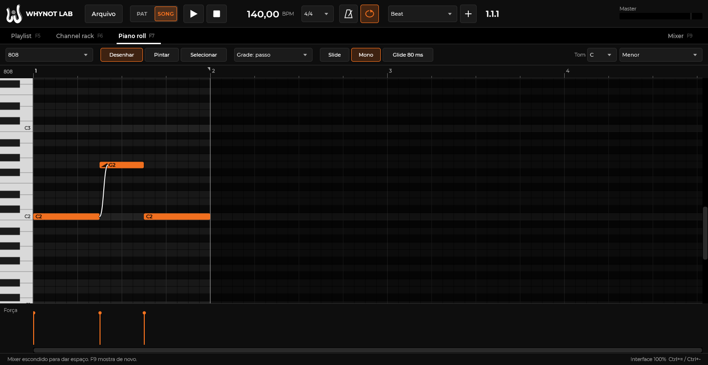
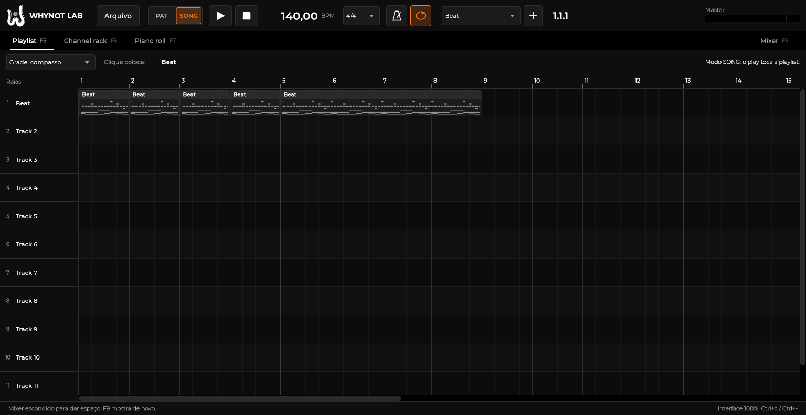

# WHYNOT LAB

> **Código aberto.** A WHYNOT LAB é software livre sob a [GNU AGPL-3.0 ou posterior](LICENSE).
> A beta para Windows está em [Releases](https://github.com/paulinrab-a11y/whynot-lab/releases).
> O nome WHYNOT e a logo não entram na licença: veja [Marca](#marca).

DAW desktop para produzir trap e música autoral, inspirada no fluxo de trabalho do FL Studio (channel rack, piano roll, playlist, mixer), com identidade visual própria.

## Clean-room

Reimplementação clean-room. Estudamos apenas como outras DAWs se comportam por fora (manuais, documentação pública, vídeos, fóruns, reviews). Nunca descompilamos, extraímos ou copiamos código, DLLs, skins, ícones, samples, presets ou arquivos de instalação de DAWs comerciais. Testes usam só plugins gratuitos legítimos (Vital, Surge XT, Dexed, Valhalla Supermassive).

## Estado

| Fase | Conteúdo | Estado |
|------|----------|--------|
| 0 | Ambiente e skills | concluída |
| 1 | Pesquisa de mercado (`docs/pesquisa.md`) | concluída |
| 2 | Arquitetura e licenças (`docs/arquitetura.md`, `docs/licencas.md`) | concluída |
| 3 | MVP que compila e abre | concluída: 3.1 (núcleo tocável), 3.2 (piano roll, playlist e glide do 808), 3.3 (plugins VST3: scan isolado, instrumento no rack, navegador, efeitos VST3 nos inserts) e 3.4 (acabamento, abaixo). Checklist em [`docs/fase-3-checklist.md`](docs/fase-3-checklist.md) |
| 4 | Servidor MCP | concluída: a ponte da IA no app e o servidor MCP (`docs/mcp.md`) |
| 5 | Importador parcial de `.flp` | — |

## Compilar e abrir

Passo a passo em [`docs/como-rodar.md`](docs/como-rodar.md). Resumo, num prompt "x64 Native Tools" do VS 2022:

```
git submodule update --init external/tracktion_engine
git -C external/tracktion_engine config submodule.modules/juce.url https://github.com/juce-framework/JUCE.git
git -C external/tracktion_engine submodule update --init --depth 1
cmake -S . -B build -G Ninja -DCMAKE_BUILD_TYPE=Release
cmake --build build --target whynot_lab -j 3
build\whynot_lab_artefacts\Release\"WHYNOT LAB.exe"
```

O alvo `whynot_lab` basta para abrir o app. O autoteste (`--self-test`) também precisa do `whynot_test_plugins`, e o `ctest` precisa do `whynot_audio_tests` e do `whynot_dsp_tests` (seções 3 e 10 do `como-rodar.md`).

## Acabamento (3.4)

- Exportar em **MP3** (LAME, até 320 kbps ou VBR), **MIDI** (uma faixa por canal) e **stems** (um WAV por trilha, escolhendo quais).
- **Salvar nova versão** (`_2`, `_3`), **autosave** a cada 2 minutos e **recuperação** depois de uma queda.
- **Atalhos** estilo FL Studio ou WHYNOT, com editor para trocar qualquer tecla.
- **Navegador de sons** (Alt+F8), com prévia por cima da música.
- **ASIO**, **controlador MIDI** e o **teclado do computador como piano** (Ctrl+T).

## Mixagem

30 efeitos nativos (entre eles afinação de voz, EQ e EQ dinâmico, compressor com sidechain, de-esser, transiente, clipper,
saturador, lo-fi, filtro, chorus, flanger, phaser, reverb, delay, estéreo, limitador e medidor de loudness), 194 presets e estilos de mixagem prontos para **trap, funk, rap e pop**: um clique no
mixer monta a cadeia de cada trilha pelo papel dela, os buses de reverb e delay e o master no alvo de loudness do gênero.
Guia em [`docs/mixagem.md`](docs/mixagem.md).

## Ideias

Gerador de acordes, melodia, arpejo, baixo, 808 e bateria no piano roll (botão **✦ Ideias**), para **trap, drill,
funk, rap, pop, R&B, phonk e lo-fi/boom bap**, com cinco climas. Dá para descrever em português ("melodia de trap triste
em Fá menor") ou escolher à mão. As partes da mesma ideia saem na mesma progressão, e o 808 cai nos bumbos da batida.
Também lê os acordes e o tom de um canal. Guia em [`docs/ideias.md`](docs/ideias.md).

## WHYNOT Synth

Instrumento nativo para melodias, baixos e 808, com som 100% próprio: até 4 camadas (analógico e
wavetable sem aliasing, FM de 2 a 4 operadores, ruído) com unison, sub, filtro, 3 envelopes, 2 LFOs no
BPM, matriz de modulação, mono com glide nos slides do piano roll e efeitos. **400 presets** em 13
categorias (808, baixo, lead, pad, pluck, keys, bell, brass, cordas, vozes, arp/seq, FX, textura), marcados
por gênero (trap, funk, rap, pop, drill, R&B, phonk, lo-fi) e nivelados em -16 LUFS. Navegador com busca,
favoritos e prévia; botão "Variar". Guia em [`docs/synth.md`](docs/synth.md).

## Identidade

Cores, tipografia e logo seguem o GUIDE WHYNOT (detalhes em `docs/arquitetura.md`, seção 8). As regras de tela (tokens do tema, ícones, controles) estão em [`docs/design.md`](docs/design.md).

## Licença

Copyright (C) 2026 WHYNOT.

Este programa é software livre: você pode redistribuir e modificar sob os termos da GNU Affero General Public License,
versão 3 ou (a seu critério) qualquer versão posterior, publicada pela Free Software Foundation. Ele é distribuído na
esperança de ser útil, mas SEM NENHUMA GARANTIA. O texto completo está em [`LICENSE`](LICENSE).

É a licença que combina o JUCE (AGPLv3) e o Tracktion Engine (GPLv3 ou posterior). O que vem de terceiros e sob qual
licença (LAME, SDK ASIO, SDK VST3, fontes, o piano Salamander) está em [`docs/licencas.md`](docs/licencas.md).

## Marca

O nome WHYNOT, a logo W com o globo e o selo da WHY NOT RECORDS são marcas da WHYNOT e não fazem parte da licença do
código (AGPL-3.0, seção 7e). Quem publicar uma versão modificada precisa trocar o nome e a logo.

## Telas





Mais capturas em [`docs/screenshots/`](docs/screenshots/).
