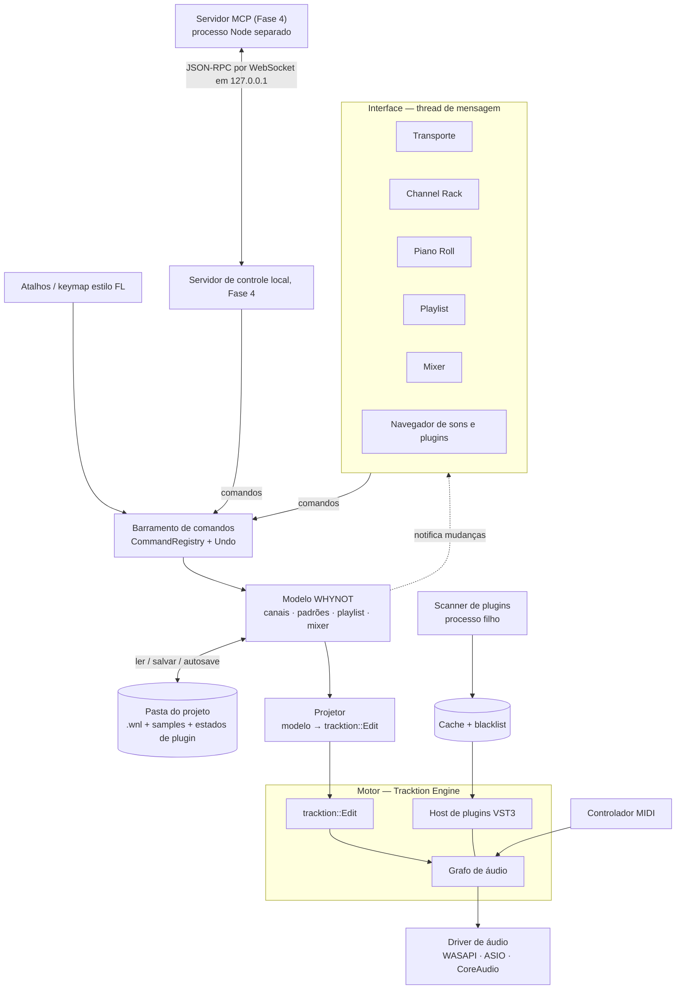
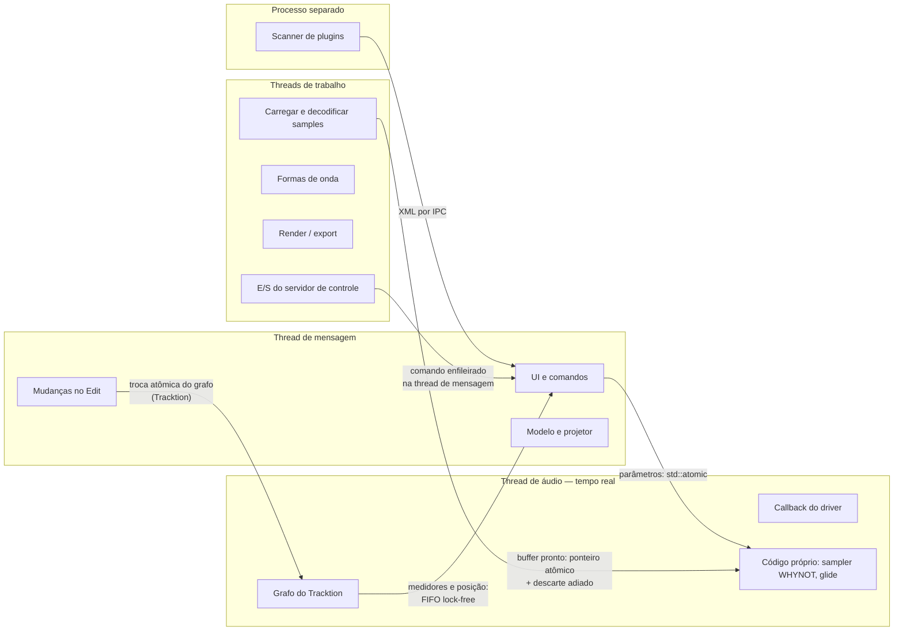
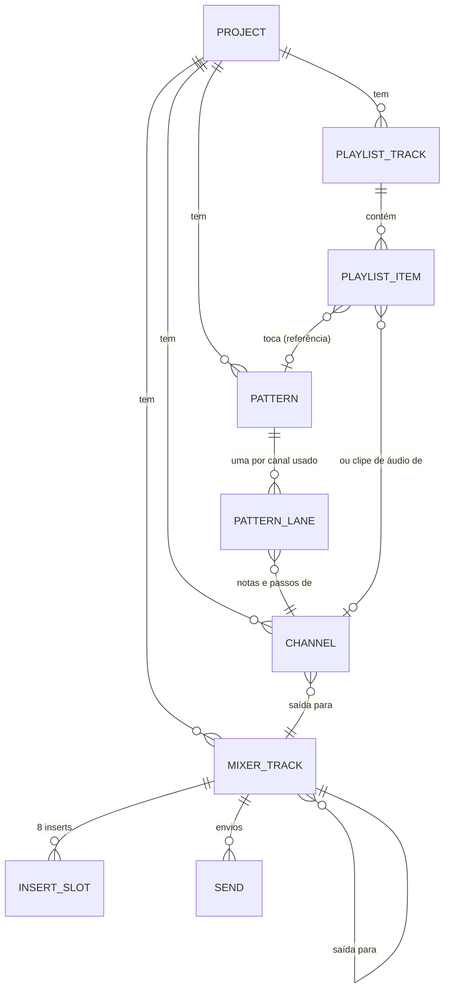
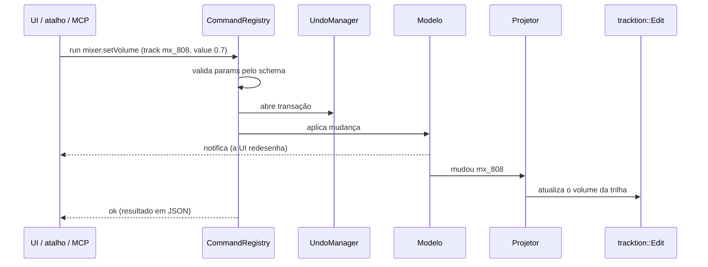

# WHYNOT LAB — Arquitetura (Fase 2)

Versão 2, 16/10/2026, conferida com o código do `integracao-fds`: o `main` d335198, com a Fase 3 inteira (3.1 a 3.4), mais as correções do fim de semana (leitura segura de JSON, teto da linha do tempo, MIDI, stems e recuperação após queda). Base: `docs/pesquisa.md` (o que entra no MVP) e `docs/licencas.md` (o que podemos usar).

As seções descrevem o desenho da Fase 2. Onde o código ficou diferente, a seção diz, e os blocos "Como ficou" contam o que foi feito. O que ainda não existe está marcado como planejado.

---

## 0. Decisões em uma tabela

| Tema | Decisão | Por quê |
|---|---|---|
| Linguagem e build | C++20, CMake 4 + Ninja, MSVC 19.44 (VS 2022) | O Tracktion exige C++20; Ninja compila mais rápido |
| Framework | **JUCE 8.0.13**, a versão que o Tracktion fixa como submódulo | O JUCE 9 já existe, mas o Tracktion ainda testa com o 8; usar a combinação que eles testam reduz bug de integração |
| Motor de áudio | **Tracktion Engine** (`develop`, commit fixado como submódulo) | Transporte, tempo, clipes MIDI/áudio, hospedagem de plugins, PDC, gravação, freeze, render e time-stretch MIT já prontos. Fazer isso do zero levaria meses |
| Fonte da verdade | **Modelo próprio da WHYNOT**, projetado num `tracktion::Edit` em tempo de execução | Os conceitos do FL (padrão que toca vários canais, playlist livre, mixer separado do canal) não cabem 1:1 no Edit; o `.wnl` fica independente do formato interno do Tracktion |
| Formato de projeto | `.wnl` em JSON legível, com versão de esquema e migração, numa **pasta de projeto** | Diff limpo entre versões, sem quebrar projetos antigos (lição do LMMS e do Zrythm) |
| Interface | **Componentes nativos do JUCE**, com tema próprio | Piano roll e playlist precisam de desenho rápido e baixa latência; uma interface web (WebView) somaria uma segunda linguagem e ~150 MB de RAM numa máquina de 7,6 GB |
| Ações | **Toda ação é um comando registrado**: a UI, os atalhos e a IA chamam a mesma coisa | Exigência da Fase 4 (MCP) e base do undo e das macros |
| IA | Servidor MCP em **processo separado** (Node + SDK oficial) falando com o app por uma porta local | Mesmo modelo do EffectCraft (`--control <porta>`); um crash do MCP não derruba o áudio |
| Plugins no MVP | **VST3** em processo; **scan em processo separado** com blacklist, tempo limite e cache | É o que a pesquisa mostrou que mais dói e o Tracktion já traz metade pronta |
| Plugins depois | Execução isolada opt-in por plugin, CLAP via formato próprio, AU no Mac | Ver seção 6 |
| Fora | VST2 (sem caminho legal), LV2 (quase nada no Windows) | Ver `docs/licencas.md` |

---

## 1. Camadas



**Como uma ação flui** (exemplo: arrastar uma nota no piano roll):
1. O piano roll gera o comando `pianoroll.updateNotes` com os IDs das notas e só os valores que mudaram (`t`, `key`...).
2. O barramento valida os parâmetros, abre uma transação de undo e aplica a mudança no modelo.
3. O modelo avisa os assinantes: a UI redesenha e o **projetor** atualiza só os clipes do Tracktion afetados por aquele padrão.
4. O Tracktion reconstrói a parte do grafo que mudou e troca a versão nova pela antiga de forma atômica, sem a thread de áudio esperar.

A IA vai fazer exatamente o mesmo caminho, só que entrando pelo servidor de controle (Fase 4). Hoje o mesmo caminho já é usado pelo autoteste e pelo modo `--render`.

---

## 2. Threads e a regra de ouro



| Thread | Quem roda | Pode | Não pode |
|---|---|---|---|
| **Áudio** | Callback do driver, grafo do Tracktion, nosso sampler | Ler `std::atomic`, ler buffers pré-alocados, escrever em FIFO lock-free | **Alocar memória, travar mutex, fazer I/O de arquivo/rede/console, lançar exceção, chamar `MessageManager`, esperar qualquer coisa** |
| **Mensagem** | UI, comandos, modelo, projetor, mudanças no Edit | Tudo, mas nada demorado (> ~10 ms vai para uma thread de trabalho) | Bloquear esperando a thread de áudio |
| **Trabalho** | Decodificar samples, desenhar formas de onda, render, socket do controle (Fase 4) | I/O e alocação | Mexer no modelo ou no Edit direto: entrega o resultado para a thread de mensagem |
| **MIDI** | Callback do driver MIDI (JUCE) | Encaminhar ao Tracktion; aprendizado de controle por FIFO | Mesmas proibições da thread de áudio |
| **Scanner** | **Processo filho** (o mesmo executável com outra linha de comando) | Carregar plugins desconhecidos | — (se travar ou cair, só ele morre) |

**Como ficou:** o autosave grava na thread de mensagem, e não numa thread de trabalho. Ele é rápido o bastante (seção 4).

### Padrões permitidos para conversar com a thread de áudio

1. **Valor simples** (volume do sampler, glide): `std::atomic<float>` escrito pela UI, lido a cada bloco, suavizado dentro do bloco para não estalar.
2. **Estrutura grande** (um sample novo carregado): a thread de trabalho monta o buffer inteiro; a thread de mensagem publica um ponteiro atômico; a thread de áudio só troca de ponteiro no início do bloco; o buffer antigo vai para uma **fila de descarte** que a thread de mensagem esvazia depois. A thread de áudio nunca libera memória.
3. **Do áudio para a UI** (medidores, posição da agulha, nota tocando): FIFO de leitor e escritor únicos; a UI lê a 30–60 Hz num `Timer`. **Como ficou:** a fila é a `SpscQueue` própria (`src/audio/SpscQueue.h`, seção 11), e não `juce::AbstractFifo`, choc ou farbot. Os medidores leem o `LevelMeasurer` do Tracktion.
4. **Mudança de estrutura** (adicionar canal, plugin, rota): sempre pelo Edit na thread de mensagem; o Tracktion recompila o grafo e faz a troca atômica.

**Revisão obrigatória:** todo arquivo que roda na thread de áudio passa pelas skills `audio-dsp-review` (segurança de tempo real) e `audio-numerics-review` (NaN, denormais, estabilidade) antes do commit, e o resultado fica anotado na mensagem do commit.

---

## 3. Modelo de dados

O modelo segue a lógica do FL, porque é o fluxo que você já conhece:



- **Canal**: toda fonte de som. Pode ser `sampler` (sampler nativo da WHYNOT), `plugin` (instrumento VST3) ou `audio` (dono dos clipes de áudio da playlist, como no FL).
- **Padrão**: guarda, para cada canal usado, os **passos** do step sequencer e as **notas** do piano roll. Colocar o padrão várias vezes na playlist cria **referências**, então editar o padrão atualiza todas as cópias.
- **Playlist**: as faixas são só raias visuais, como no FL. Cada item aponta para um padrão ou para um clipe de áudio de um canal.
- **Mixer**: trilhas com volume, pan, mute/solo, 8 inserts, envios e uma saída.

### Regras de roteamento (resposta à confusão que a pesquisa encontrou)

1. **Todo canal novo ganha uma trilha de mixer própria** e já sai roteado para ela, com o mesmo nome e cor (a trilha guarda o canal em `autoFor`). Uma preferência para desligar isso ficou para depois. Nenhum canal toca "escondido" no Master sem você ver.
2. **Toda rota é guardada pelo ID fixo do destino**, nunca pela posição. Reordenar trilhas não muda para onde nada vai.
3. **A saída aparece escrita no próprio canal e na própria trilha** ("→ 808 Bus"), e clicar nela abre a escolha de destino.
4. **Sidechain se escolhe no próprio slot do efeito** ("sidechain de: Kick"), em um clique, e fica marcado nas duas pontas.
5. Envios ficam numa lista visível em cada trilha, com o nível ao lado.

### Como o projetor traduz o modelo para o Tracktion

| Modelo WHYNOT | Vira no Tracktion |
|---|---|
| Canal (sampler ou plugin) | `AudioTrack` com o instrumento no começo da cadeia de plugins |
| Canal de áudio | `AudioTrack` com `WaveAudioClip`s |
| Padrão colocado na playlist | Um `MidiClip` por canal usado, no `AudioTrack` daquele canal, com as notas copiadas; passos viram notas de 1/16, e o roll de um passo vira notas repetidas. Bloco maior que o padrão repete o padrão |
| Nota com slide num canal mono | A nota anterior é estendida até 1 tick depois do começo da nota com slide; o sampler recebe o note-on novo com a outra tecla ainda segurada e desliza o tom (legato), sem reiniciar o sample. Nota sem slide num canal mono corta a anterior. O mesmo MIDI funciona em sintetizadores de terceiros em modo mono/legato |
| Modo PAT / SONG | PAT: o padrão atual num loop de N repetições. SONG: os blocos da playlist nos tempos certos, até o fim do último bloco |
| Trilha de mixer | `AudioTrack` sem clipes, com os 8 inserts como plugins |
| Saída canal → trilha e trilha → trilha | `TrackOutput::setOutputToTrack` |
| Envio | `AuxSendPlugin` / `AuxReturnPlugin` |
| Sidechain | `Plugin::setSidechainSourceID` |
| Medidor | `LevelMeasurer` do Tracktion |
| Congelar canal (planejado, fim de semana de 16/10) | `Track::setFrozen` |

Quando um padrão muda, o projetor regenera só os `MidiClip`s daquele padrão, agrupando mudanças em sequência (por exemplo, ao arrastar) para não recompilar o grafo a cada pixel.

O caminho de volta tem dois casos: **estado de plugin** (lido do plugin vivo no Edit na hora de salvar) e, **planejada para a 3.5**, a **gravação** (o que você grava no Tracktion vira notas do padrão ou um clipe de áudio do modelo, por comando).

---

## 4. Formato `.wnl` e pasta de projeto

```
MeuBeat/
├── MeuBeat.wnl            ← o projeto (JSON), com o estado dos plugins dentro, em base64
├── MeuBeat_2.wnl          ← "Salvar nova versão" grava ao lado: _2, _3...
├── samples/               ← cópias dos samples ("coletar arquivos" ligado por padrão)
├── autosave/              ← autosaves a cada 2 minutos; ficam os 10 mais novos
├── history/               ← cópia do arquivo de um esquema antigo, antes de salvar no esquema novo
└── renders/               ← WAV, MP3, stems e MIDI exportados
```

O desenho da Fase 2 tinha uma pasta `plugins/` com o estado binário de cada plugin, e o `history/` guardando autosaves e versões. Na 3.3 o estado foi para dentro do `.wnl` (seção 6), e na 3.4 os autosaves e as versões ganharam lugar próprio.

Exemplo resumido, no esquema 4 de hoje. Os blocos `sample` e `sampler` saem em todo canal; nos canais de plugin eles foram tirados daqui:

```json
{
  "format": "whynot-lab-project",
  "schemaVersion": 4,
  "app": { "name": "WHYNOT LAB", "version": "0.1.0" },
  "project": {
    "name": "MeuBeat",
    "bpm": 140.0,
    "timeSignature": [4, 4],
    "key": { "root": "C", "scale": "minor" },
    "metronome": false,
    "loop": true,
    "songMode": false,
    "currentPattern": "pt_hook"
  },
  "channels": [
    {
      "id": "ch_808",
      "name": "808",
      "kind": "sampler",
      "color": "#E5484D",
      "sample": { "path": "samples/808_long.wav", "originalPath": "D:/Samples/808_long.wav" },
      "sampler": { "rootKey": 36, "oneShot": false, "cutItself": true, "mono": true, "glideMs": 80.0 },
      "mute": false,
      "output": "mx_808"
    },
    {
      "id": "ch_lead",
      "name": "Lead",
      "kind": "plugin",
      "color": "#A6A6A6",
      "plugin": { "name": "Surge XT", "manufacturer": "Surge Synth Team", "format": "VST3",
                  "file": "C:/Program Files/Common Files/VST3/Surge XT.vst3", "uid": "…", "instrument": true,
                  "state": "…base64…" },
      "mute": false,
      "output": "mx_lead"
    }
  ],
  "patterns": [
    {
      "id": "pt_hook",
      "name": "Hook",
      "lengthSteps": 16,
      "lanes": {
        "ch_808": { "notes": [ { "id": "…", "t": 0, "len": 1920, "key": 36, "vel": 110 },
                               { "id": "…", "t": 1920, "len": 960, "key": 43, "vel": 110, "slide": true } ] },
        "ch_hat": { "steps": [ { "i": 0, "vel": 100 }, { "i": 2, "vel": 80, "roll": 3 } ] }
      }
    }
  ],
  "playlist": {
    "tracks": [ { "id": "pl_1", "name": "Track 1" } ],
    "items": [
      { "id": "it_1", "kind": "pattern", "ref": "pt_hook", "track": "pl_1", "start": 0, "length": 15360 },
      { "id": "it_2", "kind": "audio", "ref": "ch_vox", "track": "pl_1", "start": 15360, "length": 7680, "offsetSeconds": 1.25 }
    ]
  },
  "mixer": {
    "tracks": [
      {
        "id": "mx_808", "name": "808", "color": "#E5484D", "volumeDb": -3.0, "pan": 0.0, "mute": false, "solo": false,
        "output": "mx_master", "autoFor": "ch_808",
        "inserts": [
          { "id": "fx_1", "kind": "whynot", "type": "eq", "bypass": false, "preset": "…", "params": { "…": 0.0 } },
          { "id": "fx_2", "kind": "whynot", "type": "comp", "bypass": false, "sidechain": "mx_kick", "params": { "…": 0.0 } },
          { "id": "fx_3", "kind": "vst3", "type": "…", "bypass": false, "plugin": { "…": "…", "state": "…base64…" }, "params": {} }
        ],
        "sends": [ { "to": "mx_reverb", "db": -12.0 } ]
      },
      { "id": "mx_master", "name": "Master", "output": "device", "…": "…" }
    ]
  }
}
```

Regras do formato:
- **Tempo musical em ticks** (960 por semínima; o passo tem 240), para que uma mudança de BPM não mova notas. O número não vai no arquivo: é fixo no app.
  O que é tempo *dentro de um arquivo de áudio* (o corte do começo de um clipe) fica em segundos do arquivo
  (`offsetSeconds`, esquema 3), para que uma mudança de BPM não mude o trecho que toca.
- **IDs fixos e legíveis** (`ch_`, `pt_`, `mx_`, `it_`, `fx_`, mais um sufixo único), nunca índices. O master é sempre `mx_master`.
- **Chaves sempre na mesma ordem e indentação fixa**, para o diff entre versões mostrar só o que mudou. Campos opcionais (`slide`, `roll`, `offsetSeconds`, `preset`, `sidechain`, `autoFor`, `role`) só saem quando têm valor.
- **Estado do plugin em base64**, no campo `plugin.state` do canal ou do insert `vst3`, e não em `plugins/` como no plano. O salvamento continua atômico, num arquivo só (seção 6, "Como ficou na 3.3").
- **Caminho do sample relativo à pasta do projeto**, com o caminho original (`originalPath`) guardado para achar o arquivo se ele sumir. O hash do sample, que estava no plano, não foi feito.
- **`schemaVersion` + migradores**: o app lê os esquemas antigos e converte na memória. Ao salvar por cima de um arquivo de esquema antigo, guarda antes uma cópia do original em `history/<nome> (esquema N).wnl`, uma por esquema (`wnl::keepOlderSchema`). Arquivo de esquema mais novo que o app é recusado com uma mensagem. Nunca um formato de mão única.
  - Esquema 2: a mixagem nativa (inserts `whynot`, envios, sidechain, papéis).
  - Esquema 3: o corte do áudio em `offsetSeconds`.
  - Esquema 4: o canal `synth` do WHYNOT Synth, com o bloco opcional `"synth"` (preset e parâmetros). Um app antigo trocaria o tipo desconhecido por sampler e perderia o canal ao salvar, então o esquema sobe.
- **Arquivo estragado não derruba o app**: o JSON é lido com teto de aninhamento (`src/common/SafeJson.h`, 256 níveis), e os números passam por limites no `normalise` (por exemplo, o início e a duração de blocos e notas têm teto de 10.000 compassos).
- **Autosave** (3.4): a cada 2 minutos, se houve mudança desde o último salvar, e pelo comando `project.autosave`. Grava na thread de mensagem, de forma atômica (arquivo temporário e depois renomear), em `autosave/` na pasta do projeto, e ficam os 10 mais novos. Projeto nunca salvo vai para `%APPDATA%\WHYNOT LAB\Autosave`. O autosave "antes de carregar plugin ou de render", que estava no plano, não foi feito: a recuperação de plugin usa o `carregando-plugin.txt` (seção 6).

---

## 5. Comandos (base da IA e do undo)

Cada comando tem:

| Campo | Exemplo |
|---|---|
| `id` | `pianoroll.addNotes` |
| `title` | "Adicionar notas" |
| `params` | JSON Schema (para validar e para a IA saber o que mandar) |
| `undoable` | `true` |
| `run(ctx, params) → result` | devolve os IDs criados, em JSON |

Domínios que existem no `main` d335198:
- `transport.*`: tocar, parar, pausar, BPM, compasso, loop, metrônomo, PAT/SONG;
- `project.*`: novo, abrir, salvar, nova versão, autosave, renomear, tom e os exports (`exportWav`, `exportMp3`, `exportMidi`, `exportStems`);
- `channel.*`, `pattern.*`, `steps.*`;
- `pianoroll.*`: `addNotes`, `updateNotes`, `removeNotes`, `clear`, `stepsToNotes`;
- `playlist.*`;
- `mixer.*`: trilhas, inserts, envios, sidechain, papéis e estilos de mixagem; `fx.*`: a lista dos efeitos nativos;
- `plugin.*` (o plugin de um canal: janela e parâmetros) e `plugins.*` (catálogo, scan, pastas, bloqueados);
- `browser.*` (a prévia do navegador de sons);
- `audio.*` (aparelhos), `midi.*` (entradas e o canal que o controlador toca) e `live.*` (nota tocada ao vivo);
- `shortcuts.*`, `edit.*` (desfazer e refazer) e `view.*`.

O plano tinha um domínio `render.*`: os exports ficaram em `project.*`. A gravação (`transport.record`) é da 3.5.



- **Atalhos** (3.4): as teclas apontam para **ações** do `KeyMap` (`src/app/KeyMap.cpp`), como `view.files` ou `ui.zoomIn`, que o `MainComponent::buildActions` liga aos comandos e às telas. Os dois presets, "Estilo FL Studio" e "WHYNOT", ficam no código. Só as trocas do usuário vão para `%APPDATA%\WHYNOT LAB\atalhos.json`, e um arquivo estragado volta ao preset FL.
- **Planejado (Fase 4):** a IA vai descobrir os comandos por `command.list` (ID, título e schema) e executar por `command.run` ou `command.batch`, como no EffectCraft. O registro já tem o ID, o título e o schema de cada comando; falta o servidor.
- Macros (encadear comandos com um atalho) saem quase de graça daqui, numa fase seguinte.

---

## 6. Hospedagem de plugins

### MVP

- **Formato**: VST3 (o SDK vem no JUCE e é MIT).
- **Execução**: dentro do processo do app. É o ponto fraco consciente do MVP, mitigado pelos itens abaixo.
- **Scan em processo separado**:
  1. Ligar o scanner do Tracktion: sobrescrever `EngineBehaviour::canScanPluginsOutOfProcess()` para devolver `true` e chamar `PluginManager::startChildProcessPluginScan()` logo no início do app (o próprio executável vira scanner quando recebe a linha de comando certa).
  2. **Diário de scan** (o "dead man's pedal" do JUCE): antes de testar cada arquivo, gravar o caminho num arquivo; se o processo filho cair, o próximo scan põe aquele plugin na blacklist.
  3. **Tempo limite por plugin** (30 s por padrão): um vigia na thread de mensagem mata o processo filho se ele ficar pendurado, por exemplo num diálogo de licença. Isso o Tracktion não faz.
  4. **Cache**: a lista de plugins conhecidos fica em `%APPDATA%\WHYNOT LAB\plugins.xml`; só se testa arquivo novo ou com data de modificação diferente.
  5. **Blacklist visível**, com botão "reativar" por plugin.
- **Navegador de plugins**: busca, favoritos e separação por instrumento, efeito e fabricante.
- **Estado**: cada instância salva o estado em `plugins/<id>.bin`, referenciado no `.wnl`.
- **Recuperação após crash**: um diário de sessão marca "carregando ou abrindo a janela do plugin X". Se o app abrir depois de um fechamento sujo, ele mostra qual plugin estava em uso e oferece **abrir o projeto com plugins desligados**.

### Como ficou na 3.3

- **Scan próprio, não o do Tracktion.** O scanner fora do processo do Tracktion espera para sempre um plugin que trava. O da WHYNOT (`src/plugins/PluginCatalog`) chama o próprio app com `--scan-plugin <arquivo> <saída.xml>`, espera em fatias de 100 ms até o limite (30 s; o autoteste usa 6 s) e mata o processo filho quando passa do tempo ou quando o app pede para cancelar. O filho desliga as janelas de erro do Windows e captura exceções do plugin (SEH): código 3 = exceção, código de exceção do Windows = o processo caiu. Tudo isso vira o motivo mostrado em Bloqueados.
- **Cache** em `plugins.xml`, com uma "assinatura" por arquivo (data e tamanho do pacote e do binário de dentro). Arquivo igual não é reaberto; bloqueado não é reaberto até você desbloquear.
- **Registro antes de abrir.** Toda instância de plugin passa pelo `PluginManager::createPluginInstance` do Tracktion, que a WHYNOT substitui. Antes de abrir, o app grava qual plugin está abrindo em `carregando-plugin.txt` e apaga depois. Se o arquivo existir na abertura seguinte, o app caiu abrindo aquele plugin: ele vai para Bloqueados e a barra de status avisa. O bloqueio vale também dentro de projetos (`EngineBehaviour::shouldLoadPlugin`), então um projeto que derrubava o app abre com o canal em silêncio e marcado. Isso cobre o "abrir com plugins desligados" do plano.
- **Estado dentro do `.wnl`**, em base64 no campo `plugin.state` do canal, e não em `plugins/<id>.bin` como planejado. Assim o salvamento continua atômico, num arquivo só. Um Surge XT ocupa uns 90 KB. Se projetos com muitos plugins ficarem pesados, o estado passa para arquivos ao lado do `.wnl` sem mudar o resto.
- **Uma instância viva por canal.** O projetor cria o plugin uma vez e só refaz se for outro plugin, ou se ele não abriu e o catálogo mudou (scan novo, desbloqueio). O estado mora no plugin vivo e vai para o modelo ao salvar, ao exportar e ao fechar a janela do plugin, sem passo de desfazer. O render monta um Edit próprio, com uma segunda instância aberta com esse estado.
- **Ponto único para criar VST3:** `src/engine/PluginHost` (`create`, `readState`, `problemFor`, `refFrom`). Os inserts do mixer usam o mesmo ponto para o tipo `vst3`: o insert guarda um `PluginRef` com o estado, o projetor refaz o plugin só se virar outro (ou se não abriu e o catálogo mudou), guarda o estado antes de reordenar a cadeia e aplica o bypass com `setEnabled`. Comando `mixer.addPluginInsert`.
- **Projeto alterado**: alguns plugins (o Surge XT, por exemplo) devolvem bytes diferentes para o mesmo som. Por isso o estado novo sempre vai para o modelo, mas o projeto só fica marcado como alterado se uma janela de plugin foi aberta desde o último salvar, ou se um parâmetro mudou por comando.
- **Janela do plugin** pelo `UIBehaviour::createPluginWindow` do Tracktion, que fecha a janela quando o plugin sai do projeto. Plugin sem editor ganha o editor genérico do JUCE com os parâmetros. Os plugins nativos registram o editor deles em `PluginWindow::nativeEditorFactory`.
- **Navegador**: busca, instrumentos e efeitos separados, pastas, bloqueados com motivo e desbloqueio. Os favoritos (a estrela) vieram em 21/10 (`favorites.*`, `favoritos.json`).
- **Validação**: pluginval nível 5 nos dois plugins de teste, no Surge XT e no Surge XT Effects (todos passam). O código de hospedagem roda todo na thread de mensagem; o que roda na thread de áudio é do Tracktion e do JUCE.

### Depois do MVP: execução isolada

- Por plugin, opt-in ("rodar em processo separado"), no modelo do "Run as" do REAPER e do "Make bridged" do FL. Não é tudo isolado por padrão, porque o Ardour mostra que isso não escala em sessão grande.
- Um executável auxiliar `whynot-pluginhost` hospeda o plugin; o áudio vai e volta por memória compartilhada com um bloco a mais de latência, informada ao PDC.
- Se ele cair, o slot fica em silêncio com o aviso "plugin travou — recarregar", e o resto do projeto continua tocando.
- O custo é a janela do plugin passar a pertencer a outro processo (foco de teclado e redimensionamento dão trabalho), e mais memória por instância.

### Outros formatos

| Formato | Quando | Como |
|---|---|---|
| AU | Quando houver build de Mac | O JUCE hospeda nativamente |
| CLAP | Depois do MVP | O JUCE não hospeda CLAP: escrever um `AudioPluginFormat` próprio sobre a API C do CLAP (MIT) |
| LV2 | Não | Quase nenhum plugin útil no Windows |
| VST2 | Não | Sem caminho legal; para um plugin antigo específico, usar um plugin ponte comercial (ver `licencas.md`) |

### Sobre a validação com `vst3-review`, `clap-review` e `pluginval`

Uma ressalva honesta: essas ferramentas foram feitas para **validar plugins**, e a WHYNOT é um **host**. O uso útil delas aqui é:
- `vst3-review`: revisar o nosso código que conversa com plugins VST3 (ordem de chamadas, threads, estado).
- `clap-review`: quando escrevermos o formato CLAP.
- `pluginval`: validar os plugins gratuitos de teste antes de usá-los, para separar "bug do plugin" de "bug da WHYNOT". O download do pluginval espera o seu ok.

---

## 6b. Mixagem nativa (como ficou)

Não estava no desenho da Fase 2. Os detalhes de uso estão em `docs/mixagem.md`.

- **Efeitos próprios** em `src/dsp/`, escritos do zero: 11 efeitos, 89 presets e 4 estilos de mixagem (trap, funk, rap e pop). Os testes medidos ficam em `tests/dsp/test_dsp.cpp`, o teste `dsp` do `ctest`.
- **No motor**, cada efeito nativo é um plugin do Tracktion (`src/engine/WhynotFx`) no slot do insert. O insert guarda `kind: "whynot"`, o `type` do efeito, os `params` e o `preset`.
- **O projetor** sincroniza os inserts e os envios de cada trilha (`syncInserts` e `syncSends`). O sidechain vem de outra trilha, pelo `Plugin::setSidechainSourceID`.
- **Estilo de mixagem**: aplica a receita de um gênero pelo papel de cada trilha (`role`), cria os buses de reverb e delay com os envios e monta o master. É um passo de desfazer só.
- **Esquema 2** do `.wnl`.
- As janelas dos efeitos ficam em `src/ui/fx/`.

## 6c. Como ficou na 3.4

- **MP3**: LAME 3.100 compilado junto (`src/engine/Mp3Encoder`, opcional no build, LGPL), 44,1 kHz, 128 a 320 kbps ou VBR, com a tag ID3 e o quadro do LAME para tocar sem silêncio a mais.
- **MIDI**: `src/engine/MidiExport`, 960 PPQ, uma faixa por canal, com as notas como o motor toca. Notas na mesma tecla não se sobrepõem.
- **Stems**: um render por trilha em solo, no `AppController::exportStems`. Por padrão sem a cadeia do master, para a soma dar a mixagem; com `masterChain`, cada stem passa pelo master.
- **Versões, autosave e recuperação**:
  - "Salvar nova versão" grava `_2`, `_3`... ao lado;
  - o autosave é o da seção 4;
  - cada app aberto grava uma marca em `%APPDATA%\WHYNOT LAB\sessoes\` (`src/app/Session`). Na abertura, uma marca de um processo que não é mais a WHYNOT quer dizer queda, e o app oferece o último autosave.
- **ASIO** (SDK opcional no build), a janela de áudio e MIDI (F10), o **controlador MIDI** (`midi.*`) e o **teclado do computador como piano** (`live.note`).
- **Atalhos**: o `KeyMap` da seção 5, com o editor de atalhos.
- **Navegador de sons** com prévia: o `PreviewPlayer` entrega o som à thread de áudio pelo `RtObjectSlot` e para por um contador atômico (`stopRequests`), sem travar. Comandos `browser.preview` e `browser.stopPreview`.
- **`AppServices`** (`src/commands/CommandRegistry.h`) só cresce por acréscimo, com virtuais que têm um padrão que não faz nada. Assim o modo sem janela compila sem implementar tudo.
- **Autoteste por área** (d335198): `src/app/selftest/`, um arquivo por área, com o `SelfTestContext` (relatório, app, modelo, pastas e o que passa de uma área para a outra). A ordem é Core, Composition, Mixing, Plugins, Finishing e, por último, "Arquivos inválidos". Cada frente acrescenta o seu arquivo. No `main` são 205 verificações ok.

---

## 7. Servidor MCP (Fase 4: como ficou)

O plano detalhado e as decisões estão em `docs/fase-4-plano.md`, e o guia de uso em `docs/mcp.md`.

- **A ponte no app** (`src/control/`): um WebSocket próprio, só em 127.0.0.1, com JSON-RPC 2.0. O JUCE 8 não tem servidor WebSocket.
  - Liga só com `--control <porta>` (com janela) ou `--headless --control <porta | 0>` (sem janela).
  - O token é novo a cada vez que o app abre e fica no arquivo de controle, `%APPDATA%\WHYNOT LAB\control\<porta>.json`.
  - O `Host` e o `Origin` são conferidos, contra páginas da web e DNS rebinding.
  - Os métodos: `hello`, `app.status`, `command.list`, `command.run`, `command.batch`, `project.inspect`, `render.preview`, `ui.screenshot` e `app.quit` (só sem janela).
  - Os pedidos rodam na thread de mensagem, um por vez, e esperam o seu gesto acabar. A rede fica em threads de trabalho.
- **Cada comando da IA** vira um passo de desfazer "IA: <título>". O lote (`runBatch` do `CommandRegistry`) vira um passo só, tudo ou nada.
- **A tabela de risco** (`CommandPolicy.cpp`) põe cada comando em livre, pede confirmação ou só pela tela. Comando novo precisa de uma linha nela, e o autoteste falha sem ela. A IA usa sem perguntar só as pastas permitidas.
- **A confirmação:** com janela, um cartão na tela (`src/ui/AiBridgeUi.*`); sem janela, um ticket do app que o cliente de IA confirma por elicitação.
- **O registro e o botão:** o `ia.log` e o aviso "IA conectada", com "Desligar a IA".
- **Ver e ouvir:** o `render.preview` mede o som no app (LUFS do `dsp::LoudnessMeter`). O `ui.screenshot` captura a tela; sem janela, de um `MainComponent` montado fora da área de trabalho.
- **O servidor MCP** (`mcp/`, TypeScript, Node 24) usa o SDK oficial v2 (`@modelcontextprotocol/server` 2.3.1). Ele segue a spec 2026-07-28 em stdio e atende os clientes 2025-11-25.
  - As 6 tools, no estilo do EffectCraft: `command_list`, `command_run`, `command_batch`, `get_project`, `render_preview` e `screenshot`.
  - No modo sem janela, o servidor abre o próprio app, com `--parent-pid`, e o app fecha junto com ele.

---

## 8. Interface

- Componentes nativos do JUCE com um `LookAndFeel` próprio (`whynot::LookAndFeel`, em `src/ui/Theme`); no Windows, o renderizador Direct2D do JUCE 8.
- **Escala global da interface** (80% a 200%, Ctrl+= e Ctrl+-) pensada para monitor grande de estúdio, com texto mínimo de 13 px em 100%.
- Painéis no estilo do FL: Playlist ao centro, Navegador à esquerda, e Channel Rack, Piano Roll e Mixer como painéis que abrem e fecham por atalho (F5 a F9, no preset estilo FL).
  - **Como ficou na 3.2**: em vez de janelas flutuantes, a parte de cima mostra uma tela por vez, em abas (Playlist F5, Channel rack F6, Piano roll F7), e o mixer fica embaixo (F9). Num notebook as janelas soltas se atropelam; as abas cabem em qualquer tela. Em tela baixa o mixer sai sozinho para dar espaço ao piano roll e à playlist e volta no channel rack. Janelas destacáveis para dois monitores ficam para depois do MVP.
  - **Piano roll**: notas em laranja (são o que toca), seleção com contorno branco, slide marcado por uma rampa no começo da nota e uma curva branca que vai da altura da nota anterior até a nota com slide no tempo do glide, que é exatamente o que o sampler faz. As linhas seguem o teclado (tecla preta escura, branca clara) e a escala do projeto fica num fio na beira da grade, com a tônica em laranja; as notas dos outros canais do padrão aparecem de fundo, em cinza.
  - **Playlist**: blocos de padrão com a miniatura das notas de cada canal (e a divisão de cada repetição); clipes de áudio com a forma de onda (`juce::AudioThumbnail`, carregada em segundo plano). Em SONG o bloco que está tocando ganha um traço laranja em cima.
- **Identidade visual: GUIDE WHYNOT** (o guia da marca manda; as escolhas da skill `frontend-design` foram ajustadas a ele na entrega 3.1):
  - **Cores**: preto `#000000` no fundo, cinza `#a6a6a6` para texto secundário, branco `#ffffff` para texto, laranja `#ff751f` só para o que está aceso ou tocando. As superfícies usam cinzas neutros derivados do preto. O vermelho de clipe nos medidores é funcional e fica fora da paleta de propósito.
  - **Tipografia**: Montserrat (secundária do guia, licença OFL, embutida no app) em toda a interface. A Horizon (principal do guia) entra nos títulos e na marca quando o arquivo da fonte for adicionado; até lá, Montserrat Bold.
  - **Logo**: o W do guia, extraído em vetor do PDF; branco na barra de transporte e preto sobre quadrado branco no ícone do app.
  - **Elementos**: o hexágono do guia é o LED de mute dos canais. A estrela e o brilho duplo ficam guardados para estados especiais (gravação, conquistas), sem decorar a tela à toa.
  - **Estilo**: minimalista e tecnológico, como pede o guia. Nomes de canal em placas limpas com borda na cor do canal (a ideia anterior de fita crepe saiu por ser analógica demais para a marca).
- Laranja sobre fundo escuro lembra o FL Studio, mas é a cor da marca WHYNOT. A diferença fica no preto puro (o FL usa cinza-azulado), na logo, na tipografia e no layout próprio. Nada de skin, ícone ou cor copiados da Image-Line.

---

## 9. Pastas do repositório

```
whynot-lab/
├── CMakeLists.txt
├── external/tracktion_engine/   ← submódulo (traz o JUCE 8.0.13); o LAME e o ASIO SDK, opcionais, também ficam em external/, fora do git
├── assets/         ← marca e fontes
├── src/
│   ├── app/        ← main, AppController, linha de comando, sessão e atalhos (KeyMap)
│   │   └── selftest/   ← autoteste, um arquivo por área
│   ├── ui/         ← componentes e tema
│   │   └── fx/     ← janelas dos efeitos nativos
│   ├── model/      ← modelo, .wnl, migradores
│   ├── commands/   ← registro de comandos e undo
│   ├── engine/     ← projetor, sampler e efeitos como plugins do Tracktion, render, MP3, MIDI, prévia
│   ├── plugins/    ← catálogo e scan isolado de VST3
│   ├── dsp/        ← efeitos nativos da mixagem — revisão RT obrigatória
│   ├── audio/      ← núcleo de tempo real (fila, entrega de objetos, voz do sampler) — revisão RT obrigatória
│   └── common/     ← texto com acento (`_t`) e leitura segura de JSON
├── tests/          ← audio/ e dsp/ (rodam no ctest) e plugins/ (os VST3 de teste)
├── spikes/         ← provas de conceito
└── docs/
```

Planejado: `src/control/` (o servidor local para o MCP) e `mcp/` (o servidor MCP em TypeScript), na Fase 4; `tools/flp-import/` (Python + PyFLP), na Fase 5.

---

## 10. Riscos

| Risco | Mitigação |
|---|---|
| Compilação pesada para 7,6 GB de RAM | Limitar jobs; medido na prova de conceito (seção 11) |
| API do Tracktion mudar | Submódulo fixado em commit; atualizar só de propósito, com teste |
| Projetor lento ao editar | Atualização por padrão e por canal, agrupando edições em sequência |
| Plugin travar dentro do processo (MVP) | Diário de sessão + abrir sem plugins; isolamento logo depois do MVP |
| Glide de 808 em plugins de terceiros | MVP só no sampler nativo; depois, pitch bend ou portamento MIDI, que depende de cada plugin |
| Escopo grande para uma pessoa | Fase 3 em 4 entregas que tocam som; commits pequenos; documentação |

---

## 11. Prova de conceito desta fase

`spikes/engine-render/` monta um Edit do Tracktion a 140 BPM com 8 notas no sintetizador interno 4OSC, renderiza um WAV sem interface e mede o arquivo para garantir que não é silêncio.

**Resultado medido nesta máquina (15/10/2026):**

| Medida | Valor |
|---|---|
| Build do zero (Release, Ninja, 3 jobs) | **8,1 min**, 41 passos, executável de 12 MB |
| RAM somada dos compiladores no pico | 1,1 GB |
| Memória livre mínima da máquina durante o build | **0,02 GB** (o resto estava com outros programas abertos; o Windows passou a usar disco) |
| WAV gerado | 2 canais, 48 kHz, 3,43 s (2 compassos a 140 BPM), pico −11,1 dBFS, RMS −16,6 dBFS |
| Tempo de render | 1,3 s |

Consequência prática: compilar com **no máximo 3 jobs** e, de preferência, com navegador e outros apps pesados fechados. Builds incrementais (mexendo só no código da WHYNOT) são bem mais rápidos que o build do zero, porque o JUCE e o Tracktion não recompilam.

**Núcleo de tempo real (`src/audio/`)**, o padrão de referência para todo código da thread de áudio:
- `SpscQueue.h`: fila de um produtor e um consumidor, capacidade fixa, sem trava.
- `RtObjectSlot.h`: entrega objetos grandes (samples) à thread de áudio sem que ela aloque ou libere memória.
- `SampleVoice.h`: voz do sampler com glide de tempo constante (o slide do 808), rampas sem estalo e parâmetros saneados.

Esses arquivos passaram por `audio-dsp-review` (nenhuma violação crítica; corrigidos: verificação de atomics lock-free, denormais no carregamento, documentação de `publish` com áudio parado) e por `audio-numerics-review` (corrigidos: glide sem acumular erro de float, NaN nos parâmetros, limite de durações). `tests/audio/test_audio_core.cpp` cobre tudo isso: 16 verificações, todas passando, incluindo 5.000 trocas entre duas threads reais sem vazamento e um glide de uma quinta medido em 65,40 Hz → 98,00 Hz.

---

## 12. Plano da Fase 3 em quatro entregas

| Entrega | Conteúdo | Pronto quando |
|---|---|---|
| **3.1 Núcleo tocável** | Janela e tema; transporte (play, stop, BPM, compasso, metrônomo, loop); channel rack com sampler nativo e 16 passos; mixer simples (volume, pan, mute/solo, medidores); salvar e abrir `.wnl`; exportar WAV; configuração de áudio (WASAPI) | Você monta um beat de bateria de 16 passos, salva, reabre e exporta um WAV que soa igual |
| **3.2 Composição** | Piano roll (desenhar, mover, redimensionar, apagar, velocity, snap, pintar, ghost notes); tonalidade do projeto; glide do 808 no sampler; playlist com padrões e clipes de áudio; edição básica de clipe | Você escreve um 808 com glide e uma melodia, arranja na playlist e exporta |
| **3.3 Plugins** | Scan isolado + blacklist + cache; VST3 como instrumento e nos 8 inserts; estado salvo no projeto; navegador de plugins; recuperação após crash | Surge XT tocando no channel rack, um efeito VST3 num insert, e um plugin que trava no scan sem derrubar nada |
| **3.4 Acabamento** | MP3 (LAME), MIDI, stems escolhendo as trilhas; ASIO; entrada MIDI de controlador; atalhos configuráveis com preset estilo FL; autosave com versões; `docs/como-rodar.md` | O checklist inteiro da Fase 3 funcionando, com screenshots |

**Andamento**: a Fase 3 está concluída e no `main` (c905ade): 3.1; 3.2 em 2026-10-16; 3.3 e 3.4 também em 16/10, com a mixagem nativa (seção 6b). Depois veio o autoteste por área (d335198): 205 verificações ok e ctest 2/2. Na 3.2, "edição básica de clipe" ficou em mover, mudar a duração, copiar e aparar o começo do áudio; fade e esticar o tempo do áudio ficam para depois. Para escrever melodia sem plugins (eles chegam na 3.3), o kit ganhou um sino sintetizado.
