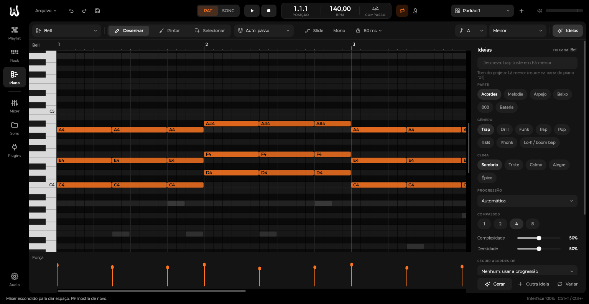

# WHYNOT Ideias

Gerador de acordes, melodia, arpejo, baixo, 808 e bateria por gênero, dentro do piano roll. Faz o papel de
ferramentas como o MIDI Wizard: você escolhe (ou descreve) o estilo, ele escreve as notas no canal e você edita à vontade.

Tudo é da WHYNOT (`src/ideas/`): progressões, ritmos e batidas foram escritos por nós a partir das convenções de cada
gênero (tutoriais e guias públicos). Não há melodia, preset ou padrão copiado de produto nenhum. O gerador é feito de
regras de teoria musical e sorteio controlado. Não é um modelo treinado. Por isso funciona sem internet, responde na
hora, a mesma semente sempre dá a mesma ideia e dá para testar automaticamente.

## Onde fica

Piano roll (F7) → botão **✦ Ideias** na barra. O painel abre à direita da grade.

1. **Descreva** (opcional): escreva o que quer e aperte Enter. Exemplos:
   - `melodia de trap triste em Fá menor, 4 compassos`
   - `808 de drill sombrio em F#m 142 bpm`
   - `acordes de R&B calmo, bem elaborado`
   - `batida de funk mandelão`
   - `boom bap jazzy, minimalista`

   O painel mostra o que entendeu ("Entendi: parte: Melodia · gênero: Trap · clima: Triste · tom: Fá menor ·
   4 compassos"), ajusta os controles, muda o tom/BPM do projeto se você pediu, e gera.
2. Ou escolha à mão: **parte**, **gênero**, **clima**, **progressão** (automática ou uma da lista, já com os nomes
   dos acordes no tom do projeto), **compassos**, **complexidade** e **densidade**.
3. **Nova ideia** sorteia outra progressão e outra batida e gera a parte escolhida no canal aberto.
4. **Gerar** usa a ideia atual. Por exemplo: com os acordes prontos no Bell, abra o canal 808, escolha a parte 808 e
   aperte Gerar. O 808 sai na mesma progressão e cai nos bumbos da mesma batida. A bateria (parte "Bateria") vai
   para os canais do kit pelo nome: Kick/Bumbo, Clap/Caixa, Hat/Chimbal, Open hat, Perc.
5. **Variar** gera outra versão só daquela parte, com os mesmos acordes.
6. **Seguir acordes de**: em vez de uma progressão, usa os acordes que outro canal já toca (o baixo segue o piano
   que você gravou, por exemplo).
7. **Analisar** lê as notas do canal aberto e mostra os acordes e o tom provável; **Usar tom** muda o tom do projeto.

Cada geração é **um passo de desfazer** (Ctrl+Z). Por padrão ela substitui as notas do canal nesses compassos.

## As partes

| Parte | O que faz |
|---|---|
| **Acordes** | Voicings com condução de vozes (as notas andam o mínimo de um acorde para o outro), no ritmo do gênero: pads longos no trap, stabs no funk, piano sincopado no lo-fi. R&B e lo-fi abrem o voicing e põem a fundamental embaixo. |
| **Melodia** | Um motivo curto que se repete e se adapta aos acordes (forma A a A B no trap, A B a b no pop). Nos tempos fortes, notas do acorde; no meio, notas da escala. O clima muda o contorno: triste desce, alegre sobe, sombrio fica no grave e usa a segunda menor quando a escala tem. |
| **Arpejo** | As notas do acorde em sequência (sobe, desce, sobe e desce ou alterna), em semicolcheias ou tercinas. |
| **Baixo** | Fundamental, quinta, oitava e notas de aproximação para o próximo acorde, no groove do gênero. |
| **808** | Segue o bumbo da batida da mesma ideia, segura até a próxima nota, salta oitava no fim do compasso e desliza (slide). No drill o 808 vira linha melódica. Se houver slide, o canal passa para mono, que é o que faz o glide funcionar. |
| **Bateria** | Batidas de 2 compassos para os passos do channel rack: bumbo, caixa/palmas, chimbal com rolls, open hat e percussão. A cada 4 compassos, uma virada no chimbal. "Variar" mexe em chimbal, caixa e percussão, nunca no bumbo, que o 808 segue. |

## Os gêneros

| Gênero | BPM | Como soa |
|---|---|---|
| **Trap** | 130–160 | Caixa no tempo 3, chimbal com rolls, 808 longo com slides de vez em quando; melodias curtas em loop. |
| **Drill** | 138–145 | Chimbal em grupos de 3, caixa deslocada, 808 que desliza muito e vira melodia; tons escuros. |
| **Funk** | 125–150 | Funk BR: tamborzão (bumbo no 1 e no 3 com o empurrão do surdo), palmas no 2 e no 4, percussão no contratempo, 808 junto do bumbo e curto. |
| **Rap** | 85–100 | Caixa no 2 e no 4, piano e cordas, baixo conversando com o bumbo. |
| **Pop** | 95–128 | Tom maior, frases de dois compassos, baixo marcando, refrão que gruda. |
| **R&B** | 60–100 | Sétimas e nonas, voicings abertos, sem pressa. |
| **Phonk** | 130–160 | Cowbell curto em loop, modo frígio, 808 distorcido. |
| **Lo-fi / boom bap** | 70–92 | Acordes jazzy, poucas notas, muito espaço. |

**Climas:** Sombrio, Triste, Calmo, Alegre, Épico. Eles escolhem a progressão e mudam o contorno da melodia e a força das notas.

**Tom:** o do projeto (as caixas no canto da barra do piano roll). Em escalas de 7 notas (frígio, dórico, menor
harmônica) as sétimas e nonas automáticas também seguem a escala, para não brigar com a melodia.

## Progressões

Escritas em graus romanos no modo do tom: maiúsculo é acorde maior, minúsculo é menor. `b` antes abaixa meio tom.
Depois do grau: `7`, `maj7`, `9`, `add9`, `sus2`, `sus4`, `o` (diminuto), `h7` (meio-diminuto). `*2` dura o dobro.

| Exemplo | Em Lá menor |
|---|---|
| `i VI III VII` | Am F C G |
| `i iv VI V` | Am Dm F E (o V maior da menor harmônica) |
| `i bII i bII` | Am Bb Am Bb (frígio) |
| `i*2 VI*2` | Am (2 compassos) F (2 compassos) |
| `iih7 V7 i7 i7` | Bm7b5 E7 Am7 Am7 |

O banco tem 32 progressões marcadas por gênero e clima. Para usar outra, mande pelo comando (`progression`).

## Para a IA (comandos)

| Comando | Faz |
|---|---|
| `ideas.options` | Gêneros (com BPM e clima padrão), climas e partes. |
| `ideas.progressions` | As progressões do gênero/clima, com os nomes dos acordes no tom. |
| `ideas.generate` | Gera uma parte. Parâmetros: `part` (chords, melody, arp, bass, 808, drums), `channel`, `genre`, `mood`, `bars`, `at`, `root`, `scale`, `complexity`, `density`, `seed`, `variation`, `progression`, `follow`, `octave`, `replace`, `channels` (bateria). Devolve a semente, os acordes e um resumo. |
| `ideas.detectChords` | Acordes e tom provável de um canal (ou de todos). |
| `ideas.parse` | Entende um pedido em português e devolve os ajustes. |

A mesma `seed` em partes diferentes dá a mesma progressão e a mesma batida. É assim que os acordes, a melodia, o
808 e a bateria combinam. Na Fase 4 (MCP), a IA usa esses mesmos comandos.

## Limites conhecidos

- O channel rack ainda não tem tercina por passo (o swing por canal já existe: `channel.setSwing`). As tercinas do
  chimbal do drill saem como grupos de 3 na grade de semicolcheias, e os rolls usam o roll do passo (2, 3, 4, 6).
  Melodias e arpejos usam tercinas de verdade.
- A detecção de tom é uma sugestão. Em progressões ambíguas (ex.: `IV V iii vi`) ela pode apontar a relativa.
- O texto entende palavras-chave, não frases livres. O que ele não reconheceu fica de fora, e o painel mostra o que entendeu.
