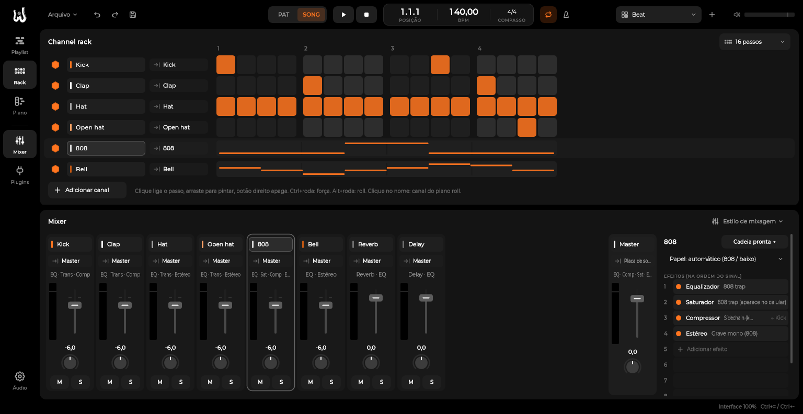
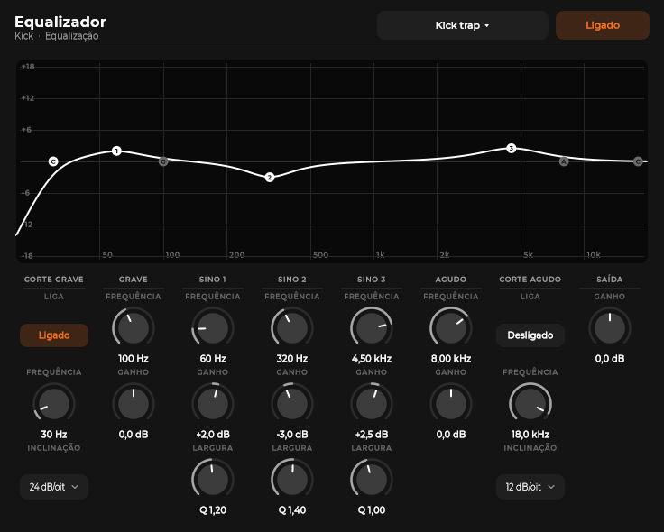
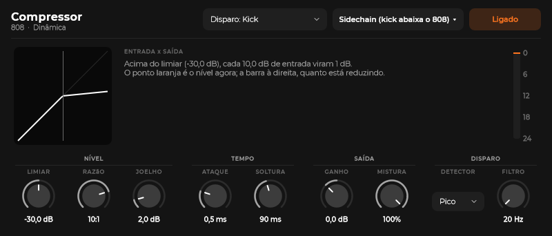
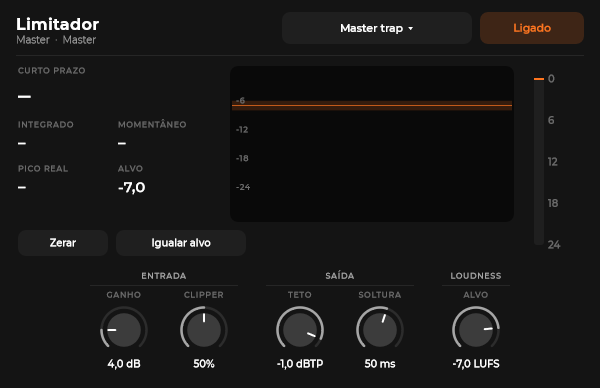

# Mixagem na WHYNOT LAB

Efeitos nativos, presets e estilos de mixagem para trap, funk, rap e pop. Tudo é da WHYNOT: DSP escrito do zero
(`src/dsp/`), sem copiar código, presets ou curvas de DAW ou plugin comercial. Os presets são pontos de partida
pensados a partir de práticas de mixagem conhecidas; o ouvido decide o resto.

## Onde ficam

- **Mixer (F9):** cada trilha mostra embaixo da saída o resumo da cadeia ("EQ · Comp · Sat"). Clique numa trilha
  e a cadeia dela aparece no **painel da direita**: papel da trilha, os 8 slots de efeito e os envios.
- **Slot vazio:** clique e escolha o efeito já com um preset (ou "Padrão"). Os efeitos VST3 encontrados no scan
  aparecem em "Plugins VST3".
- **Slot com efeito:** clique abre a janela; o ponto laranja liga e desliga (bypass sem estalo); botão direito tem
  preset, sidechain, mover, trocar e remover; arrastar muda a ordem.
- **Estilo de mixagem** (botão no topo do mixer): aplica a receita de um gênero em todas as trilhas, cria os buses
  de reverb e delay com os envios e monta o master. **Ctrl+Z desfaz tudo de uma vez.**
- **Cadeia pronta** (no painel): a receita do gênero só para a trilha escolhida. Se a receita tem envio, o comando
  também cria o bus de reverb ou de delay que faltar (ou troca a cadeia do bus que já existe) e liga ou remove os
  envios da trilha. No master o botão vira **Cadeia de master**, com o alvo de loudness de cada gênero.
- **Papel:** no topo do painel, "Papel: automático (X)" mostra o que o app adivinhou pelo nome. Dá para escolher outro.
- **+ Envio:** cria o bus (com o EQ de retorno) e liga o envio a -12 dB. O controle do envio vai de -60 a +6 dB, e um
  duplo clique volta a -12. Por comando, o envio vai de -100 a +6 dB. O botão **PRÉ** de cada envio deixa ele
  pré-fader (ver "Solo, pan, envios e master" abaixo).
- **Arrastar um VST3** do navegador de plugins para um slot também põe o efeito ali.

## Os 24 efeitos

No menu do slot eles vêm por categoria: Voz, Equalização, Dinâmica, Cor, Espaço, Imagem e Master. Os doze marcados
com "(novo)" entraram em 21/10 e estão explicados em [Voz gravada em casa e beat pronto](#voz-gravada-em-casa-e-beat-pronto-efeitos-de-2110).

| Efeito | Para quê | Destaques |
|---|---|---|
| **Afinação** | Voz afinada: do natural ao efeito robô | Tom e escala que seguem o projeto, velocidade de 0 a 400 ms, força, **humanizar**, faixa da voz, mistura; mostra a nota que sai e quanto está corrigindo |
| **Tom da voz** (novo) | Ad-lib grosso, fino, uma oitava abaixo | Tom em semitons e formante à parte (PSOLA): a voz muda de nota sem virar fita acelerada |
| **Harmonia** (novo) | Refrão e ad-lib com coro | 1 ou 2 vozes em terças, quintas ou oitava, na escala do projeto, já afinadas, com formante e largura |
| **Limpa-voz** (novo) | Tirar o ruído de fundo da voz gravada em casa | Aprende o ruído sozinho; redução, sensibilidade, suavidade, ouvir o ruído; 21 ms de latência compensada |
| **Nivelador de voz** (novo) | A voz sempre na frente, sem mexer no fader | Alvo, faixa, velocidade e sensibilidade (não sobe o ruído nas pausas) |
| **Console** (novo) | A trilha de uma mesa num efeito só | Corte grave, gate, compressor, EQ de 3 bandas e cor de válvula |
| **Dobrador** (novo) | Voz mais grossa e larga, ad-lib aberto | 2 ou 4 cópias, atraso, desafinação, largura, corte grave, modo coro |
| **Equalizador** | Tirar o que embola, realçar o que precisa aparecer | Passa-altas 12/24/48 dB/oit, prateleiras, 3 sinos, passa-baixas, curva arrastável e analisador de espectro |
| **EQ vintage** (novo) | Peso sem embolar, ar no topo | Reforço e atenuação no mesmo grave, agudo com largura, corte de ar |
| **Gate** (novo) | Calar o ruído e o vazamento entre as frases | Gate ou expansor, histerese, segurar, antecipação de 1,5 ms, **disparo de outra trilha** |
| **Compressor** | Segurar picos, dar corpo, colar | Joelho suave, pico ou RMS, mistura paralela, filtro do detector, **sidechain de outra trilha** |
| **Comp óptico** (novo) | Compressão suave e musical | Redução e ganho; soltura em dois estágios que depende do programa |
| **Comp FET** (novo) | Rápido e agressivo, com cor | Razões 4 a 20 e "Todos", ataque de microssegundos, cor de transistor, mistura |
| **Multibanda** (novo) | Segurar só uma faixa de frequência | 4 bandas Linkwitz-Riley (soma plana), **disparo por banda**: a voz abre espaço no beat |
| **De-esser** | Tirar o chiado do "s" | Só agudos ou banda toda, "ouvir sibilância" |
| **Transiente** | Mais punch ou mais macio, sem limiar | Ataque e sustentação independentes |
| **Saturador** | Harmônicos, calor, peso | Fita, Válvula, Suave, Duro, Fuzz; 4x sobreamostrado; **proteger graves** (sub do 808 limpo); compensar volume |
| **Grave+** (novo) | O 808 aparecer no celular | 2º e 3º harmônicos só do grave, cor, sub original |
| **Filtro** | Telefone, lo-fi, intro abafada | Passa-baixas/altas/banda/rejeita, 12/24 dB, ressonância, drive |
| **Reverb** | Espaço | Sala, Placa, Salão (rede de atraso com 8 linhas e modulação) |
| **Delay** | Eco no tempo | Sincronizado ao BPM (1/32 a 1 compasso, com tercinas e pontuadas) ou tempo livre de 1 a 2000 ms, pingue-pongue, filtros, abaixa sob a voz |
| **Estéreo** | Imagem | Largura 0-200%, grave mono abaixo de uma frequência, balanço, inverter fase, conferir em mono |
| **Limitador** | O último do master | Antecipação de 2 ms, pico real (4x), clipper suave antes, medidor LUFS e "Igualar alvo" |
| **Medidor** | Medir sem mudar o som | LUFS momentâneo, curto prazo e integrado (BS.1770), pico real, correlação |

Detalhes técnicos que importam no uso:

- **"1 compasso" do delay vale sempre 4 tempos.** Só o BPM chega ao efeito: em 3/4, isso é mais que um compasso.
- **Faixas do limitador:** ganho de 0 a 24 dB, teto de -12 a 0 dBTP, soltura de 1 a 1000 ms, clipper de 0 a 100% e alvo
  de -20 a -4 LUFS. No Medidor, o alvo vai de -24 a -4 LUFS.
- **No máximo 10 efeitos por trilha** (eram 8 até 22/10; 10 como no FL).

- **Sem estalo:** mexer em qualquer parâmetro tocando, ligar/desligar, trocar tipo, curva ou inclinação faz
  transição suave (testado em `tests/dsp`).
- **Latência compensada:** saturador, Comp FET e Console (38 amostras), gate (1,5 ms), limitador (~3 ms), afinação (15 ms),
  limpa-voz (21 ms a 48 kHz), tom da voz e harmonia (50 ms) informam a latência e o motor alinha o resto (conferido no autoteste: o ataque não sai do lugar).
- **Disparo de outra trilha (sidechain):** no compressor, nos comps óptico e FET, no gate e na multibanda.
- **Render igual ao que se ouve:** os valores entram sem rampa no começo do export.

### Afinação de voz

O primeiro efeito da cadeia da voz. Ele acha a nota que a voz está cantando, puxa para a nota mais perto da escala
e entrega a voz deslocada, sem mudar o tempo.

- **Tom e escala:** ao entrar no mixer, o efeito pega o tom do projeto (as caixas do piano roll). Com **Seguir o tom do
  projeto** ligado (o padrão), ele muda junto quando o tom do projeto muda. Escolher o tom ou a escala na janela do
  efeito desliga o seguir. Carregar um preset não muda o tom.
- **Velocidade:** 0 ms salta na hora entre as notas, o efeito robô. De 10 a 40 ms é a voz afinada de trap e funk,
  e de 80 a 150 ms soa natural.
- **Força:** quanto da distância até a nota certa é corrigido. A 60% a voz só é puxada para perto.
- **Voz:** a faixa de tom procurada (grave, aguda ou ampla). Estreitar a faixa evita que um som grave do fundo engane o detector.
- **Humanizar:** nas notas longas a correção fica mais lenta e o vibrato passa; a troca de nota continua rápida
  (ver [Afinação: duro, humanizado e no tom do projeto](#afinação-duro-humanizado-e-no-tom-do-projeto)).
- **Presets:** Natural, Pop, Trap / funk (rápido), Robô, Só um toque, Duro (trap), Duro com vibrato e Natural humanizado.

Como funciona, em resumo: a detecção usa o método YIN sobre a voz reduzida para 12 kHz, e o deslocamento usa
duas cabeças de leitura numa linha de atraso. A emenda entre elas cai sempre num múltiplo exato do período da
voz, então não estala.

Nos testes (`tests/dsp`), com uma voz sintética (o número é o pior trecho medido):

| Entrada | Saída |
|---|---|
| Lá 40 cents acima | 1,6 cent do Lá |
| Lá 35 cents abaixo | 1,1 cent |
| 452 Hz na escala cromática | Lá, a 0,8 cent |
| Glissando de 430 a 450 Hz | parado no Lá, no máximo 2,4 cents de desvio |

Correções abaixo de 2 cents não são aplicadas: não se ouvem, e assim a voz já afinada passa sem mexer.

Limites:
- É para uma voz de cada vez: acordes e instrumentos com várias notas confundem o detector.
- As formantes andam junto com o tom. Em correções grandes (mais de um semitom) o timbre muda um pouco.
- A latência é de 15 ms. O motor compensa no render e na mixagem; numa gravação ao vivo com o efeito ligado, ela se sente.

## Voz gravada em casa e beat pronto (efeitos de 21/10)

Doze efeitos entraram para quem grava a voz em casa e mixa em cima de um beat pronto. Eles cobrem as categorias de
um pacote de plugins profissional (compressores clássicos, multibanda, channel strip, nivelador, dobrador, realce de
grave, redução de ruído), com nomes e DSP nossos. A pesquisa do que existe e do que cada um faz está em
`revisoes/pesquisa-2026-10-21-pacote-waves.md`, na pasta de coordenação fora do repositório (só comportamento, de fontes públicas).

### Uma cadeia de voz que funciona

Na ordem dos slots, da gravação para a mix:

1. **Limpa-voz** (se a gravação tem ruído de fundo): preset "Quarto (leve)" ou "Ventilador / ar".
2. **Gate** em modo expansor, preset "Voz em casa": abaixa o quarto entre as frases.
3. **Afinação** (o tom vem do projeto): "Duro (trap)" ou "Natural humanizado".
4. **Nivelador de voz**, preset "Rap (rápido)" ou "Canto (natural)": a voz chega por igual no compressor.
5. **Equalizador** (ou o EQ do **Console**): corte grave, menos 250 Hz, presença.
6. **Comp óptico** "Voz suave" e, se quiser mais pressão, o **Comp FET** "Voz controle rápido" depois.
7. **De-esser** (ou a **Multibanda** "Voz: sibilância e chiado").
8. **Dobrador** nos refrões e ad-libs: "Dobra larga (refrão)" ou "Ad-lib aberto". Para coro afinado, a **Harmonia**
   ("Terça e quinta (acorde)"); para o ad-lib grosso ou uma oitava abaixo, o **Tom da voz** numa trilha de ad-libs.
9. Reverb e delay nos envios, como nos estilos.

O **Console** junta 1 a 7 numa janela (corte grave, gate, compressor, EQ e cor), com presets "Voz rap", "Voz trap",
"Voz funk" e "Voz cantada": é o caminho rápido para quem está começando.

No **beat pronto** (o instrumental num WAV ou MP3): **EQ** "Beat: espaço para a voz" e a **Multibanda** "Beat: abre
espaço para a voz" com o disparo na trilha da voz. O beat abaixa só os 1,8 a 5 kHz enquanto a voz canta e volta
nas pausas. É a receita do papel "Beat pronto" em todos os estilos.

### Cada efeito

| Efeito | O que faz | Como usar na voz e no beat | Medido nos testes (`tests/dsp`) |
|---|---|---|---|
| **Tom da voz** | Muda o tom em semitons (-12 a +12) e, à parte, a formante (-7 a +7): marca o começo de cada período da voz, recorta grãos de dois períodos e os recoloca no espaçamento do tom novo (PSOLA). Consoantes e respiração passam sem mudar. Latência fixa de 50 ms, compensada | Ad-libs: "Voz grossa (funk)", "Oitava abaixo (dobra)" em paralelo, "Ad-lib monstro", "Outro timbre" para a dobra | Com 0 e 0 sai a entrada atrasada, exata; uma voz de 220 Hz sai em 329,6, 164,8 e 110,0 Hz (+7, -5 e -12 st; erro abaixo de 0,1 cent) com o volume a ±0,5 dB; uma voz em glissando com vibrato acompanha a +5 st com no máximo 11 cents de erro por janela e sem estalo; numa voz com formante em 1 kHz, +7 st deixa o harmônico mais forte em 989 Hz, e a formante +5 st leva para 1319 Hz (esperado ~1335) |
| **Harmonia** | Lê a nota cantada a cada 5 ms, acha a nota da escala do projeto que fica 2 graus (terça) ou 4 graus (quinta) acima ou abaixo, ou a oitava exata abaixo, e lê os mesmos grãos do PSOLA nesse tom. As vozes novas saem afinadas e ficam caladas nas consoantes. Formante, nível e largura (duas vozes, uma de cada lado). Segue o tom do projeto, como a afinação | Refrão: "Terça e quinta (acorde)"; ad-lib pesado: "Oitava abaixo (peso)" | Graus conferidos em Lá menor, Dó maior e na cromática; uma voz em Lá 3 ganha Dó 4 a -6,7 dB (sem a harmonia, -50 dB nessa frequência); com terça e quinta, Dó 4 a -8,1 dB e Mi 4 a -7,3 dB; ruído sem tom sai igual (as vozes não entram) |
| **Gate** | Abre acima do limiar, fecha só alguns dB abaixo (histerese), segura e solta. Modo expansor: abaixo do limiar, cada dB a menos vira 2 (a razão). Antecipação fixa de 1,5 ms: o começo da palavra não é comido. Aceita disparo de outra trilha e tem filtro no detector | Voz em casa: expansor com 10 a 20 dB de redução. Rap seco: gate com 25 dB. "808 picotado": gate no 808 com disparo no chimbal | Fecha a faixa inteira no silêncio (ruído -30,0 dB com redução 30); aberto, sai igual à entrada atrasada (diferença 1,8e-7); o primeiro milissegundo passa (-0,17 dB); expansor 2:1 a 10 dB do limiar: -9,9 dB; oscilar ±1 dB no limiar não trepida (0 trocas) |
| **Comp óptico** | Um botão de redução (o limiar desce de 0 a -40 dB), ganho e modo comprimir (3:1) ou limitar (10:1). Ataque perto de 10 ms; soltura em dois estágios, mais lenta quanto mais tempo comprimiu. Realce opcional dos agudos no detector | O primeiro compressor da voz: 40 a 60% de redução e o ganho devolvendo o volume | 14 dB acima do limiar: 9,35 dB de redução (esperado 9,33); 150 ms depois de o som baixar sobram 5,2 dB, 1,5 s depois 2,4 dB; depois de 3 s comprimindo sobra mais (5,2 dB) que depois de 0,3 s (3,4 dB) |
| **Comp FET** | Limiar, razões 4, 8, 12, 20 e "Todos" (esmaga), ataque de 20 µs a 0,8 ms, soltura de 50 a 1100 ms, cor de transistor (4x sobreamostrada) e mistura | Depois do óptico, para a voz de rap na cara; "Voz paralela" e "Esmagar (todos)" em paralelo | 4:1 a 14 dB acima: 10,44 dB (esperado 10,5); a cor dá o 3º harmônico previsto (-37,0 dB); o rebatimento de um 15 kHz com cor fica em -118 dB; latência 38 amostras, medida = informada |
| **Multibanda** | 4 bandas com divisores Linkwitz-Riley e compensação de fase; limiar, razão e ganho por banda; ataque e soltura gerais; ouvir uma banda só. Com disparo, cada banda é disparada pela mesma banda da outra trilha | Voz: segurar só o médio duro ou os "s". Beat: abrir espaço para a voz (disparo na voz). Master: "Master: multibanda leve" | Com tudo em 0 dB a soma é plana: diferença máxima 0,0001 dB em 31 frequências; a banda 3 a 4:1 reduz 17,9 dB (esperado 17,9) e 200 Hz não muda; com o disparo da voz o beat perde 10 dB em 3 kHz e 0,00 dB em 200 Hz |
| **Nivelador de voz** | Sobe e desce o ganho devagar até o alvo, dentro da faixa; desce mais rápido do que sobe; abaixo da sensibilidade (pausa, ruído) o ganho para; não sobe na cauda das frases | Antes do compressor: a voz que oscila de frase para frase chega igual | Frases de -31,8 e -11,8 dB saem em -19,7 e -18,2 dB (alvo -18); na pausa depois da frase alta o ganho sobe só 0,45 dB |
| **Dobrador** | 2 ou 4 cópias com 5 a 40 ms de atraso e poucos cents de desafinação (modulação lenta e irregular do atraso), abertas nos lados, sem o grave; modo coro | Refrão e ad-libs. Para não aparecer: "Dobra justa" (35%) | Com as cópias em 0% a voz passa igual (diferença 0) e sem latência; correlação 0,67 com largura 100% e 1,000 com 0%; 8 cents viram ±1,37 ms de variação no atraso e 8,00 cents de desvio máximo |
| **Grave+** | Divide na frequência escolhida e gera o 2º e o 3º harmônicos só do grave, com a quantidade independente do volume; dá para tirar parte do sub | 808 e baixo que somem no celular: "808 no celular"; para ganhar volume no master: "Menos sub, mais volume" | 50 Hz a -12 dBFS: 100 Hz e 150 Hz no nível previsto (-12,1 e -12,3 dB do fundamental); 20 dB a menos na entrada = 20,00 dB a menos nos harmônicos; com 0% de harmônicos, plano (0,0000 dB) |
| **Limpa-voz** | Gate espectral numa STFT de 1024 pontos: aprende o ruído de fundo sozinho nas pausas (1 a 2 s), fecha cada faixa abaixo da sensibilidade, com suavidade para não soar "aquático". Onde há som forte, a estimativa do ruído sobe devagar: nota longa não é comida. "Ouvir o ruído" toca só o que sai | Antes de tudo na voz gravada em casa. 8 a 15 dB de redução; se aparecer voz no "Ouvir o ruído", diminua a sensibilidade | Latência 1024 amostras (21 ms a 48 kHz), medida = informada; com redução 0 sai a entrada atrasada (diferença 1,8e-7); ruído branco a -50 dBFS desce 10,9 dB nas pausas (redução 12) e a voz fica igual (-0,02 dB); numa nota de 5 s sem pausa, o último segundo sai igual (-0,07 dB; sem a proteção, -4,6 dB) |
| **Console** | Corte grave 24 dB/oit, gate, compressor (rápido ou lento), EQ de 3 bandas e cor de válvula 4x sobreamostrada | Voz pronta numa janela; também "Bateria" e "Beat (2 pistas)" | Tudo desligado: a entrada atrasada 38 amostras (diferença 8,9e-7); EQ medido = analítico; gate fecha 24,7 dB no ruído; compressor 10,53 dB (esperado 10,5) |
| **EQ vintage** | Grave com reforço e atenuação na mesma frequência (20, 30, 60 ou 100 Hz), agudo com reforço e largura, corte de ar; controles de 0 a 10 | Kick e 808: o reforço e a atenuação juntos dão peso com um vale logo acima (menos embolado). Voz: ar em 16 kHz | Medido = analítico (erro 0,000 dB); os dois no máximo em 60 Hz dão +3,6 dB em 35 Hz e -2,9 dB em 110 Hz |

Todos os efeitos, com os padrões: silêncio entra e silêncio sai; um sinal de +60 dBFS e um impulso não dão NaN,
infinito nem número desnormal; e todos os presets processam ruído sem explodir (`tests/dsp`, "Robustez").
**Nada disso foi ouvido ainda:** os números são medidas com sinais de teste (senos, ruído e uma voz sintética).

### Afinação: duro, humanizado e no tom do projeto

- **Duro (trap):** velocidade 0 e humanizar 0. A nota salta na hora e fica reta. Uma voz com vibrato de ±40 cents
  sai com ±7,9 cents (antes desta versão eram ±26: o detector passou a olhar as amostras mais novas, e a medida
  chega quase junto com a leitura).
- **Humanizar:** numa nota que dura mais de 120 ms, a correção vai ficando mais lenta (até +350 ms), e o vibrato
  passa (±39 dos ±40 cents com 100%). A troca de nota continua na velocidade. Preset "Duro com vibrato".
- **Seguir o tom do projeto** (ligado por padrão): mudar o tom ou a escala do projeto muda a afinação junto, no
  mesmo passo de desfazer. Escolher o tom na janela do efeito desliga.

## Minhas cadeias e meus presets

O artista monta a voz uma vez e usa em toda música.

- **Meu preset** (de um efeito nativo): na janela do efeito, o menu de presets tem **Salvar como meu preset…**.
  Ele aparece em "Meus presets" no mesmo menu, no menu do slot e no menu de pôr efeito, em qualquer projeto.
  O preset da afinação não guarda o tom: ele continua vindo do projeto. Fica em `meus-presets.json`, na pasta
  de dados do app (`%APPDATA%\WHYNOT LAB`). O mesmo nome no mesmo efeito substitui.
- **Minha cadeia** (todos os efeitos de uma trilha, nativos e VST3 com o estado): no painel do mixer,
  **Cadeia pronta → Salvar os efeitos desta trilha como cadeia…**. Para usar, o mesmo menu lista as cadeias salvas;
  carregar troca os efeitos da trilha, num passo de desfazer. Cada cadeia é um arquivo `.wnl` pequeno em
  `cadeias/` na pasta de dados: dá para mandar para outra pessoa. Apagar manda o arquivo para `cadeias/apagadas`.
- Ao carregar uma cadeia, os efeitos ganham ids novos, o disparo (sidechain) fica vazio (a trilha que disparava era
  de outro projeto) e a afinação pega o tom do projeto.

## Rack com 8 macros (bloco 4c, 23/10)

Cada trilha tem 8 **macros**: um knob que move vários parâmetros dos efeitos dela de uma vez ("Brilho" sobe o agudo do
EQ e o drive da saturação juntos).

- **Onde:** no painel de efeitos, o título **MACROS**, entre os efeitos e os envios, abre e fecha os 8 knobs. Ele abre
  sozinho numa trilha que já tem macros ligados. Um macro sem nada ligado fica apagado.
- **Ligar:** botão direito num knob da janela do efeito → **Ligar ao macro** → o número. Ou botão direito no macro →
  **Ligar um parâmetro** → o efeito → o parâmetro. O que já está ligado aparece marcado, e clicar de novo desliga.
- **A faixa:** o parâmetro anda do valor em que estava (com o macro em 0) até o máximo dele; se já estava no máximo,
  ele desce até o mínimo. A conta é na posição do knob, a mesma da automação: numa frequência, o meio do macro cai no
  meio do knob. Pela IA dá para escolher a faixa (`min` e `max` na unidade do parâmetro), e o máximo menor que o
  mínimo inverte: o macro sobe e o parâmetro desce.
- **Mexer:** arrastar o macro é um passo de desfazer só; duplo clique volta a 0. O botão direito no macro também
  renomeia, volta a 0, mostra o que ele move agora (clicar desliga) e desliga tudo.
- O macro escreve o valor nos parâmetros: o efeito toca como sempre, e o projeto abre igual numa versão sem macros.
  Mexer no parâmetro sozinho vale até o macro andar de novo. Tirar um efeito tira os links dele.
- Só efeitos nativos; um VST3 fica de fora. Até 16 parâmetros por macro.
- **Minha cadeia leva o rack:** salvar a cadeia guarda os macros; carregar troca o rack da trilha (se a cadeia tiver um).
  Somando ("append"), cada macro da cadeia vai para o mesmo número, se lá não houver nada ligado, ou para o primeiro
  livre.
- **Comandos:** `mixer.macros`, `mixer.setMacro` (`value` de 0 a 1, `name`), `mixer.mapMacro` (`insert`, `param`,
  `min`, `max`) e `mixer.unmapMacro`. No `.wnl`, a trilha ganha `macros` (opcional, não sobe o esquema).
- **Controlador MIDI** (bloco 4d): botão direito no macro → **Aprender do controlador MIDI**, e um knob de verdade
  move o macro. Também no fader, no pan e em qualquer knob da janela do efeito (ver `docs/como-rodar.md`, 7e).
- Ficou para depois: automatizar o macro.

## Solo, pan, envios e master (revisão de 22/10)

- **Solo com sidechain:** com o 808 em solo, o kick que dispara o compressor dele some da saída, mas continua
  abaixando o 808, como no FL. No motor, o kick não fica mudo: ele toca para uma trilha escondida com o fader em
  -inf e sem os envios, e assim continua processando e disparando (num mudo do Tracktion, o que entra na trilha
  também cala). Ligar ou desligar um solo desses remonta o áudio por um instante. O **mute** feito pelo usuário
  corta o disparo também.
- **Stems com sidechain:** o stem do 808 sai com o mesmo abaixar da mixagem, e a soma dos stems continua dando a
  mixagem (sem a cadeia do master). Antes, o stem do 808 saía sem o kick e sem o abaixar.
- **Bus em solo:** um bus de reverb em solo toca com quem manda para ele, com a voz seca junto (como no FL). Antes
  ele ficava mudo.
- **Trilha muda não manda reverb:** nem quando ela dispara um sidechain.
- **Lei de pan:** potência constante com o centro em 0 dB. No centro nada mudou; nas pontas o lado de perto sobe
  +3,01 dB e o outro some (antes, na lei linear, subia +6,02 dB); em 50% fica +2,32 dB de um lado e -5,33 dB do outro
  (antes +3,52 e -6,02). Num som mono, mexer no pan não muda o volume que se sente. O envio pós-fader leva o pan.
  Uma mixagem com trilhas no pan fica um pouco diferente: o lado de perto desce até 3 dB.
- **Envio pré-fader** (botão PRÉ, ou `pre: true` no comando): o envio sai antes do volume e do pan da trilha, então
  abaixar o fader não tira o reverb. Numa trilha congelada ele continua enviando.
- **Fader do master antes da cadeia:** o volume e o pan do master entram antes dos efeitos do master; o limitador no
  fim segura o pico mesmo com o fader em +3 dB (antes o WAV passava de 0 dBFS), e o medidor do master, o último,
  mostra o que sai no arquivo. Com o master em 0 dB nada muda. Com o fader fora de 0 e uma cadeia no master, o som
  muda: o fader agora empurra (ou alivia) o compressor e o limitador.
- **Sidechain num VST3:** vale quando o plugin tem uma entrada de sidechain (um segundo bus de entrada). Sem ela, o
  comando explica e o menu não oferece.

## Comparar sem efeitos, no mesmo volume

Um efeito que deixa o som mais alto quase sempre parece "melhor", mesmo quando não está. A comparação tira essa
dúvida: ela alterna entre **todos os inserts em bypass** (e os envios desligados) e **como está**, os dois no mesmo
loudness. O app mede o LUFS de cada lado num render rápido e abaixa (ou sobe) o lado com efeitos até o outro.

Não é "antes do estilo": se você pôs efeitos à mão, eles também saem na comparação.

- Comando `mixer.compare` com `mode`: `bypass` (sem efeitos), `matched` (como está, no volume do sem efeitos) ou `off`.
  Ele devolve os dois LUFS e a compensação. Na tela, o botão **Comparar** na barra do mixer (Normal, Sem efeitos,
  Com efeitos no mesmo volume); ele volta para Normal sozinho quando a comparação desliga.
- Nada disso entra no projeto nem no desfazer: é só o que se ouve. A comparação desliga sozinha ao exportar, ao salvar,
  ao trocar de projeto e quando qualquer coisa muda no mixer.
- No autoteste, com o estilo trap, o lado com efeitos fica 0,5 LU ou menos acima do lado sem.

## MP3 sem picos estourados

O MP3 cria picos entre as amostras ao ser decodificado. Por isso o export de MP3 renderiza em float, passa o
áudio por um limitador de pico real a -1 dBTP e só então codifica. Ele só age quando o pico real passa de
-1 dBTP. Uma mixagem que já sai do limitador do master com teto de -1 dBTP passa sem mudar.

## Presets

São 162 ao todo: EQ 23, Compressor 13, Saturador 12, Afinação 8, Reverb 7, Transiente 6, Delay 6, Estéreo 6,
Gate 6, Multibanda 6, Console 6, EQ vintage 6, Tom da voz 6, Harmonia 6, Limitador 5, Medidor 5, Comp óptico 5, Comp FET 5, Dobrador 5,
Grave+ 5, Filtro 4, Nivelador 4, Limpa-voz 4 e De-esser 3. O nome do preset aparece no topo da janela do efeito; um `*` depois
dele avisa que algum parâmetro foi mudado. Os nomes e descrições saem no `fx.list`.

## Os estilos

Cada trilha tem um **papel**: kick, 808/baixo, caixa/clap, chimbal/percussão, melodia/sample, **beat pronto (2 pistas)**,
voz principal, vozes de apoio, efeitos, envio de reverb, envio de delay ou bus. O papel vem do nome da trilha ("Kick",
"808", "Clap", "Hat", "Beat", "Instrumental", "Type beat", "Base", "Voz", "Backing"...) ou é escolhido no painel.

- Nome que o app não reconhece vira **melodia**.
- **"Bus" nunca é adivinhado.** Um bus de grupo (uma trilha "Bateria" que recebe kick, caixa e chimbal) precisa do
  papel "Bus" escolhido no painel. Senão ele ganha a receita e os envios de melodia.

| Papel | Trap | Funk | Rap | Pop |
|---|---|---|---|---|
| Kick | EQ (peso e clique), transiente, comp punch | EQ médio-grave, saturação dura, transiente | EQ boom bap, comp paralelo NY, fita | EQ firme, comp punch, transiente leve |
| 808 / baixo | EQ, saturação com sub protegido, **sidechain do kick**, grave mono | EQ, 808 distorcido, comp, grave mono | EQ quente, comp, válvula leve, grave mono | EQ, **sidechain leve do kick**, válvula, grave mono |
| Caixa / clap | EQ, estalo, comp; reverb -14 dB | EQ, transiente seco, fuzz paralelo | EQ, estalo, paralelo; reverb | EQ, comp; reverb |
| Chimbal | EQ sem grave, curto, aberto | EQ, ataque duro | EQ, curto | EQ, aberto |
| Melodia | EQ que abre espaço, larga; reverb e delay | EQ, cola, larga | Sample lo-fi (EQ, válvula escura, cola) | EQ, cola, larga |
| Beat pronto | EQ com vale em 2-4 kHz, **multibanda disparada pela voz**, comp óptico leve, grave mono | igual, com cola de melodia | EQ, multibanda pela voz, óptico leve | igual ao trap, com imagem pop |
| Voz | EQ com ar, comp agressivo, de-esser, fita; placa e 1/4 | EQ médio na frente, comp agressivo, de-esser forte, válvula; eco de colcheia | EQ de inteligibilidade, 2 comps, de-esser; sala e slap | EQ com ar, 2 comps, de-esser, fita; salão e 1/8 pontuado |
| Vozes de apoio | EQ mais fino, comp de controle, larga | EQ mais fino, comp agressivo, larga | EQ mais fino, comp de controle, larga | EQ mais fino, comp suave, larga |
| Efeitos | EQ que limpa grave e chiado | igual | igual | igual |
| Master | EQ, cola, fita, grave mono, limitador com clipper | EQ médio, cola, clip suave, grave mono, limitador forte | EQ, cola, fita, limitador | EQ com ar, cola, imagem, limitador suave |
| Alvo de loudness | ~ -7 LUFS | ~ -5,5 LUFS | ~ -8 LUFS | ~ -9 LUFS |

Envios de cada papel, em dB (reverb / delay; "-" = sem envio):

| Papel | Trap | Funk | Rap | Pop |
|---|---|---|---|---|
| Caixa / clap | -14 / - | -20 / - | -16 / - | -12 / - |
| Melodia | -12 / -18 | -16 / -20 | -18 / - | -12 / -18 |
| Voz | -14 / -12 | -20 / -14 | -20 / -18 | -10 / -14 |
| Vozes de apoio | -10 / -14 | - / -16 | -14 / - | -8 / -16 |
| Efeitos | -12 / - | -16 / - | -14 / - | -10 / - |

O que o estilo faz com o que já existe:

- troca os efeitos das trilhas e do master pelos da receita;
- remove os envios que a receita não tem;
- não aplica receita de papel nas trilhas de bus (papel envio de reverb, envio de delay ou bus); os buses de reverb e
  de delay recebem as cadeias do estilo;
- sem trilha de kick, o compressor de sidechain do 808 vira um compressor comum, com o preset "808 / baixo controle";
- sem trilha de voz, a multibanda do beat (que só existe para a voz abrir espaço) sai da cadeia, e o resto fica.

Os alvos são referências aproximadas do que se ouve em cada gênero, não regra. As plataformas de streaming
normalizam para perto de -14 LUFS: um master mais alto que isso só soa mais baixo lá, e perde dinâmica.
O limitador tem o preset "Streaming (-14)" para quem prefere dinâmica.

Para chegar no alvo: toque a música inteira com o limitador do master aberto e clique em **Igualar alvo**. Ele
ajusta o ganho pela diferença entre o integrado medido e o alvo (sempre entre 0 e 24 dB) e zera a medição para
conferir. Sem uma medição integrada, ou seja, sem tocar antes, ele não faz nada.

## O LUFS do master, sempre à vista

Na barra de cima do mixer fica o loudness do que sai do master: tocando, o dos últimos 3 s (curto prazo); parado, o
integrado do que tocou desde o último play. Ao lado, o pico real (dBTP), em alerta acima de -1. Um clique no número
escolhe um alvo (Streaming -14, Pop -9, Rap -8, Trap -7, Funk -5,5) e mostra quanto falta ou sobra. A medida vem do
Medidor nativo, escondido no fim da cadeia do master (depois do medidor de pico): só mede, não muda o som. O alvo vale
para a sessão, fora do projeto.

## Para a IA (comandos)

Quase tudo acima é comando, como o resto do app. A exceção é a leitura de loudness: os LUFS e o pico real da
janela do limitador e do Medidor, o "Igualar alvo" e o "Zerar" só existem na tela. Para a IA medir, o `mixer.compare`
devolve o LUFS integrado de um render com e sem efeitos.

| Comando | O que faz |
|---|---|
| `fx.list` | Efeitos (parâmetros, faixas, unidades, listas), presets, estilos e papéis |
| `mixer.addInsert {track, type, preset?, slot?}` | Põe um efeito nativo |
| `mixer.addPluginInsert {track, plugin, slot?}` | Põe um efeito VST3; os parâmetros dele são `plugin.parameters` e `plugin.setParameter` com `track` e `insert` |
| `mixer.setInsertParam {track, insert, param, value}` ou `{..., params: {...}}` | Ajusta (listas aceitam o rótulo) |
| `mixer.loadInsertPreset`, `mixer.setInsertBypass`, `mixer.moveInsert`, `mixer.removeInsert`, `mixer.showInsert` | O resto do slot. `setInsertBypass` sem `on` alterna; `preset: ""` volta ao Padrão |
| `mixer.saveInsertPreset {track, insert, name}`, `mixer.deleteInsertPreset {type, preset}` | Meu preset (id `user:...`, que vale no `addInsert` e no `loadInsertPreset`); o `fx.list` traz os de cada efeito em `userPresets` |
| `mixer.saveChain {track, name}`, `mixer.listChains`, `mixer.loadChain {track, name, mode?}`, `mixer.deleteChain {name}` | Minhas cadeias. `mode: "append"` põe depois dos efeitos que já existem (até 8) |
| `mixer.setInsertSidechain {track, insert, source}` | Quem dispara o compressor, os comps óptico e FET, o gate, a multibanda ou um VST3 com entrada de sidechain |
| `mixer.setSend {track, to, db?, pre?}`, `mixer.removeSend` | Envios: pós-fader (padrão) ou pré-fader com `pre: true` |
| `mixer.setRole {track, role}`, `mixer.addTrack {name, role?}`, `mixer.removeTrack` | Papéis e buses. `role: ""` volta ao automático |
| `mixer.applyStyle {style, tracks?, master?}` | Estilo inteiro, só algumas trilhas ou só o master (`tracks: ["mx_master"]`) |
| `mixer.compare {mode, song?}` | Comparação sem efeitos x como está, no mesmo LUFS (ver acima) |

Rotas que fariam o som voltar para a própria trilha (saída, envio ou sidechain) são recusadas com explicação.

## No arquivo `.wnl`

Cada trilha de mixer tem `role`, `inserts` (id, kind, type, bypass, preset, sidechain, params) e `sends` (to, db e,
só quando ligado, `pre: true`; campo opcional, o esquema não sobe).
Os parâmetros ficam por nome, na ordem do efeito, para o diff ficar limpo.

A mixagem entrou no esquema **2** (um arquivo do esquema 1 abre sem conversão). Hoje o projeto está no esquema **3**,
desde que a 3.4 mudou o corte dos clipes de áudio. Um app antigo recusa um esquema mais novo em vez de perder dados
ao salvar, e salvar por cima de um `.wnl` de esquema mais antigo guarda o original em `history/`.
