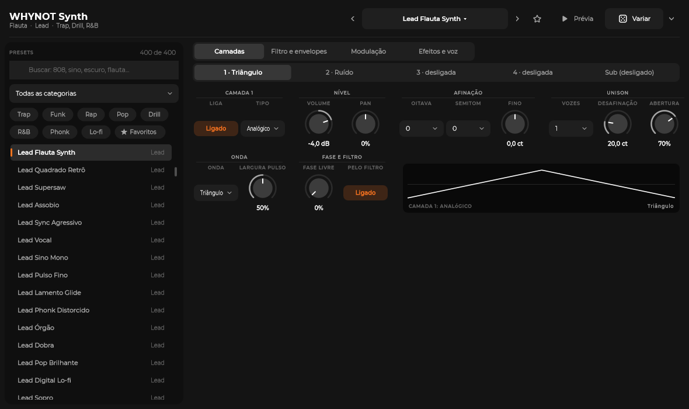

# WHYNOT Synth

O instrumento nativo da WHYNOT LAB para melodias, baixos e 808: o papel que sintetizadores como
o Zenology ou o Serum fazem num estúdio, com **som 100% próprio**. Nenhum som, preset, wavetable,
código ou nome desses produtos entrou aqui; estudamos só como esse tipo de instrumento se comporta
(manuais, vídeos, reviews) e desenhamos tudo do zero.

## Como usar

1. No channel rack, **Adicionar canal → WHYNOT Synth**. O canal ganha a própria trilha de mixer (que
   nasce em -6 dB, como os outros canais) e a janela do synth abre. Ele começa no **Init** (uma serra,
   filtro aberto) e se chama "WHYNOT Synth". O Init aparece no menu do cabeçalho, mas não no
   navegador, que conta só os 400 presets.
2. À esquerda fica o **navegador de presets**: busca (sem diferenciar acento; casa com o nome, a
   descrição e a categoria), categoria, um gênero por vez e favoritos. Esc limpa a busca. Clicar num
   preset já carrega e toca uma prévia; as setas do teclado andam pela lista.
3. No cabeçalho: setas para o preset anterior/próximo (dão a volta na lista filtrada), a lista por
   categoria, a **estrela** (favorito), **Prévia** e **Variar**. Um "*" depois do nome marca o preset
   mexido.
   - A **Prévia** toca a nota da categoria com força 100 por ataque + 700 ms (entre 450 e 2.500 ms).
   - O **Variar** muda o timbre dentro de limites musicais. O botão usa 0,3; a setinha ao lado escolhe
     Sutil (0,2), Médio (0,4) ou Forte (0,7). Ele não mexe na estrutura (tipos, ondas, rotas) nem no
     mono; rota com quantidade zero continua zero; o corte não desce abaixo do menor entre o original
     e 120 Hz.
   - Carregar preset, Variar e mexer nos botões desfazem com Ctrl+Z. A **estrela não**: o favorito é
     do usuário, não do projeto. Desde 21/10 fica no `%APPDATA%\WHYNOT LAB\favoritos.json`, com os outros
     favoritos (sons, kits, plugins e efeitos); o `synth-favoritos.txt` antigo entra nele na primeira vez e vira
     `synth-favoritos.txt.migrado`. A estrela também fica no fim de cada linha da lista de presets.
   - Com a janela em foco, os atalhos do app continuam valendo.
4. Escreva as notas no piano roll (F7). Nos presets mono (808, baixos, leads), a **nota com slide desliza**
   da anterior, como o glide do 808 do sampler. O tempo do glide e o mono são os mesmos botões do piano
   roll e da página "Efeitos e voz".
5. Duplo clique no nome do canal reabre a janela. A IA faz tudo isso pelos comandos `synth.*`.



A janela tem quatro páginas: **Camadas** (uma aba por camada, com o nome da onda, como "1 · Seno" ou
"2 · desligada", mais a aba "Sub", e o desenho da onda), **Filtro e envelopes** (curva do filtro e os três envelopes desenhados), **Modulação** (os dois
LFOs desenhados e a matriz) e **Efeitos e voz**. Capturas: `synth-camadas.png`, `synth-sub.png`,
`synth-808.png`, `synth-filtro-envelopes.png`, `synth-modulacao.png`, `synth-efeitos-voz.png` e
`synth-channel-rack.png`, em `docs/screenshots/`.

As capturas são do commit 5f9e901. Nelas as pílulas de gênero aparecem cortadas ("Tr…", "Favorit…")
e há um medidor no canto do cabeçalho; o 4553e75 encurtou os rótulos e tirou o medidor, mas ainda não
foi compilado. As capturas são refeitas no próximo build.

## Como o som é feito

Cada nota (voz) tem:

| Parte | O que faz |
|---|---|
| **4 camadas** | Cada uma é **Analógico** (serra, pulso com largura variável, triângulo, seno), **Wavetable** (15 tabelas geradas por código, a "Forma" anda pelos quadros), **FM** (2 a 4 operadores em 6 algoritmos, com realimentação e brilho que cai com o tempo) ou **Ruído** (cor de escuro a claro). Volume, pan, oitava, semitom, ajuste fino. |
| **Unison** | Até 8 cópias por camada, desafinadas e abertas no estéreo, com fase livre ou fixa. |
| **Sub** | Seno, triângulo ou quadrada uma ou duas oitavas abaixo, sem passar pelo filtro. |
| **Filtro** | O SVF da mixagem (`src/dsp/Svf.h`): passa-baixas, passa-altas, passa-banda e rejeita-banda, 12 ou 24 dB/oitava, ressonância e drive. Segue a nota, abre com o envelope e com a força. |
| **3 envelopes** | Volume, filtro e modulação, ADSR com curva (de reta a bem exponencial). |
| **2 LFOs** | 7 formas, livres em Hz ou no BPM (de 1/32 a 4 compassos, tercinas e pontuadas), por nota ou livres, com entrada suave. |
| **Matriz** | 8 rotas fonte → destino. Fontes: Env volume, Env filtro, Env mod, LFO 1 e 2, Força, Nota, Mod wheel, Aftertouch e Aleatório. Destinos: afinação, volume, forma e afinação de cada camada, corte, ressonância, drive, volume, pan, desafinação, taxa dos LFOs, sub. Em 100%, a afinação anda ±24 semitons e o corte ±8 oitavas. |
| **Voz** | Polifonia de 1 a 32 (padrão 16). Passou do limite, sai a nota mais antiga, de preferência uma já solta, com um fade de 6 ms. Mono com legato, glide só no slide ou sempre, pitch bend, força no volume e deriva analógica. A camada de ruído ignora o unison. MIDI: o mod wheel é o CC1, e o aftertouch é o de canal. |
| **Efeitos** | Saturação, EQ, estéreo, delay no BPM e reverb: os mesmos processadores da mixagem (`src/dsp`). |
| **Saída** | Volume e soft clip (linear até -1,9 dBFS, nunca passa de 0 dBFS). |

### Sem aliasing

As ondas analógicas e as wavetables vêm de **tabelas de banda limitada por oitava**: para cada altura
de nota toca a versão que só tem os harmônicos abaixo de Nyquist. O polyBLEP de 2 pontos foi medido
antes e deixava -34 dB em Dó7, por isso ficou de fora. O FM baixa o índice perto de Nyquist (regra de
Carson): nota muito aguda com índice alto perde brilho em vez de dobrar.

O que o teste mede, a 48 kHz (o que sobra fora dos harmônicos, último resultado):
- 6 osciladores em Dó6 e Dó7: serra, pulso 25% e triângulo analógicos, e as wavetables Clássica,
  Sync e Digital (3 das 15 tabelas). De -85,5 a -93,5 dB, com limite de -70 dB;
- o FM com índice máximo em Mi7: -80,1 dB (limite -50 dB);
- o sub quadrado uma oitava abaixo de Dó4: -74,7 dB (limite -70 dB).

O aliasing não é medido preset por preset, nem nas outras 12 tabelas.

### Thread de áudio

`synth::Synth` (em `src/synth`, sem JUCE) não aloca, não trava e não faz I/O no `process()`.
Os parâmetros chegam por atomics; a modulação, a afinação e o filtro andam a cada 16 amostras, com
rampas por amostra no meio. `prepare()` é o único lugar que aloca (buffers dos efeitos).

## Presets

400 presets próprios, montados em código (`src/synth/Presets*.cpp` com o construtor de
`PresetBuilder.h`), em quatro levas: os 150 primeiros, 100 de variedade, 86 reforçando rap, phonk,
funk e lo-fi e 64 completando cada categoria.

| Categoria | Presets | | Categoria | Presets |
|---|---|---|---|---|
| 808 | 46 | | Bell | 26 |
| Baixo | 42 | | Brass | 21 |
| Lead | 46 | | Cordas synth | 21 |
| Pad | 38 | | Vox synth | 21 |
| Pluck | 38 | | Arp/Seq | 26 |
| Keys | 34 | | FX | 22 |
| | | | Textura | 19 |

Cada preset tem gêneros: trap (123), funk BR (69), rap (59), pop (105), drill (88), R&B (89),
phonk (62), lo-fi/boom bap (76).

**Por gênero (revisão de 16/10).** O Ideias sugere som por gênero e parte: acordes, melodia, arpejo,
baixo e 808 (`soundCategories` em `src/ideas/Genres.cpp`). Todo par gênero × categoria que ele pede
tem pelo menos 4 presets, e o teste confere isso. Para fechar os buracos (rap em pad, pluck, sino e
arpejo; phonk em pluck e keys; lo-fi em arpejo), 19 presets que já serviam ganharam 20 gêneros, sem
mudar o som: rap +13, phonk +5 e lo-fi +2 (o `arp-suave-rnb` ganhou rap e lo-fi). O teste usa uma
cópia do mapa de `src/ideas/Genres.cpp` (`ideiasCategories` em `tests/synth/test_synth.cpp`): se o
Ideias mudar o mapa, mude a cópia. `whynot_synth_tests --genres` mostra a matriz e o perfil de cada
gênero:
- os 808 de trap, drill, pop, R&B, rap, funk, phonk e lo-fi deslizam todos (mono com glide);
- phonk tem 71% dos presets com saturação;
- lo-fi tem 92% com "poeira" (fita, deriva, filtro fechado, afinação balançando ou chiado).

Os poucos presets que destoam do gênero estão listados lá, para ouvir.

**Volume padronizado.** Cada preset é medido tocando a mesma nota por categoria (808 e baixo em Dó2,
sinos em Dó5, o resto em Dó4) com força 100, e o volume dele é ajustado para **-16 LUFS** (loudness
momentânea máxima, ITU-R BS.1770) com pico até -3 dBFS. Os timbres de acorde (pad, keys, cordas,
metais, vox) também tocam um acorde de 4 notas (menor com sétima), cujo pico fica até -2,5 dBFS,
abaixo do joelho do soft clip. Medido em 16/10, sem essa regra, 64 dos 135 encostavam no soft clip
num acorde, e 11 chegavam a 0 dBFS. Com a regra, 77 dos 135 baixaram:
- 22 menos de 1 dB;
- 44 de 1 a 3 dB;
- 10 de 3 a 6 dB;
- 1 mais de 6 dB: `cordas-curtas-funk` (-9 dB, cordas curtas para golpes de acorde).

O teste conta 55: os que ficaram mais de 1 dB abaixo do alvo por causa do acorde.

Resultado: nota sozinha entre -25,4 e -16,0 LUFS (os mais baixos são os limitados pelo acorde ou por
pico, como 808 e baixos com muita saturação), pico máximo -3,0 dBFS, acorde até -2,5 dBFS. Os
volumes ficam em `src/synth/PresetLevels.inc`, gerado pelo teste.

### Acrescentar presets

1. Escreva o preset num dos arquivos `src/synth/Presets*.cpp` (o construtor `B` usa as unidades da
   tela: dB, Hz, ms, %). Um arquivo novo de presets precisa entrar em quatro lugares: na lista
   `WHYNOT_SOURCES` do `CMakeLists.txt`, no bloco `whynot_synth_tests` do `tests/CMakeLists.txt`, na
   montagem da lista em `SynthPresets.cpp` (`presets::add...`) e na declaração em `PresetBuilder.h`.
2. Rode `whynot_synth_tests --levels src/synth/PresetLevels.inc` para medir e gravar o volume.
3. **Compile de novo**: o `PresetLevels.inc` entra no `SynthPresets.cpp` por `#include`.
4. Rode `whynot_synth_tests`. Ele confere ids únicos, gêneros, nível e pico de todos, o pico do acorde
   nos timbres de acorde, os pares do Ideias, que nenhum preset é cópia de outro, que nenhum nome ou
   descrição tem nome de produto comercial e, numa amostra de 1 a cada 7 presets (uns 58), que o
   Variar não estraga o som.

**Clean-room.** O teste recusa nome de produto comercial no nome e na descrição dos presets. Dois ids
antigos continuam com "clavinete", por compatibilidade com os `.wnl` já salvos: `keys-clavinete`
(Teclado Funk Estalado) e `clavinete-wah` (Teclado Funk Wah). A tela mostra o nome novo, mas a IA vê
o id, e ele fica gravado no `.wnl`.

## Comandos (IA e atalhos)

| Comando | O que faz |
|---|---|
| `channel.addSynth { preset?, name? }` | Canal WHYNOT Synth com a própria trilha de mixer. |
| `synth.listPresets { category?, genre?, search?, favorites? }` | Lista presets, categorias e gêneros. |
| `synth.loadPreset { channel, preset }` | Carrega um preset (inclui mono e glide). |
| `synth.setParam { channel, param, value }` ou `{ channel, params: {...} }` | Muda parâmetros por id (`flt.cutoff`, `l1.wave`...). Listas aceitam o rótulo ("Serra") e as numéricas o número (4 vozes). |
| `synth.params { channel? }` | Todos os parâmetros: id, nome, seção, faixa, unidade, opções e valor atual. |
| `synth.randomize { channel, amount?, seed? }` | "Variar" (0 a 1; padrão 0,3). |
| `synth.setFavorite { preset, on? }` | Favoritos (do usuário, não do projeto; fora do Ctrl+Z). Sem `on`, alterna. |
| `plugin.openEditor { channel }` | Abre a janela. |

Mono e glide são do canal (`channel.setMono`, `channel.setGlide`), os mesmos do piano roll; o
`synth.setParam` também aceita `mono` e `glide`.

### Faixas dos parâmetros

São 193 parâmetros: 190 na tela, mais `mono`, `glide` e `bpm`, que vêm do canal e do projeto.
`synth.params` lista todos com faixa e unidade. Os principais:

| Parâmetro | Faixa |
|---|---|
| Volume da camada | -36 a +6 dB |
| Corte do filtro | 20 Hz a 20 kHz |
| Taxa do LFO (livre) | 0,02 a 30 Hz |
| Ataque | 0,5 ms a 10 s |
| Decaimento e soltura | 1 ms a 20 s |
| Polifonia | 1 a 32 (padrão 16) |
| Pitch bend | 0 a 24 semitons (padrão 2) |
| Glide | 0 a 2.000 ms (padrão 80) |
| Volume de saída | -36 a +24 dB |

## No arquivo .wnl

Bloco opcional no canal. Arquivos sem synth abrem iguais. No merge com o `main`, o núcleo sobe o
esquema para 4: um app antigo recusa o arquivo em vez de transformar o synth em sampler e perder o
timbre ao salvar.

```json
{ "id": "ch_1a2b3c4d", "kind": "synth", "name": "808 Limpo",
  "sampler": { "mono": true, "glideMs": 70.0, ... },
  "synth": { "preset": "808-limpo", "params": { "l1.on": 1, "l1.type": 0, "flt.cutoff": 20000, ... } } }
```

Os parâmetros ficam todos gravados (4 casas), na ordem do synth: se um padrão mudar numa versão
futura, o projeto continua soando igual.

## Testes

- `whynot_synth_tests` (sem JUCE, em segundos): parâmetros, tabelas, aliasing (6 osciladores, o FM e o
  sub; limites de -70 dB, e -50 dB no FM), envelopes, roubo de voz sem clique, glide/legato, NaN e
  desnormais com 40 timbres sorteados, nível de todos os presets, Variar (1 a cada 7 presets) e
  orçamento de CPU em dois casos:
  - 16 vozes × 4 camadas (analógico, wavetable, FM de 4 operadores e ruído), com filtro de 24 dB,
    saturação e reverb: limite de 50% de um núcleo; deu de 12% a 30% no i5-1334U, conforme a carga;
  - o mesmo com unison 4 em cada camada: limite de 120%.
  Modos extras: `--cpu` (os 400 presets em polifonia cheia, os 15 mais pesados e onde vai o tempo),
  `--cpu-bench` (banco fixo para comparar versões), `--dump <pasta>` (render de cada preset, para
  comparar versões amostra por amostra), `--genres [mínimo]` (matriz gênero × categoria com os pares
  que o Ideias pede) e `--demos <pasta>` (uma demo em WAV por gênero, com um `.txt` do que toca em
  cada segundo, para ouvir).
- `--self-test` do app (`src/app/selftest/Synth.cpp`): canal synth, busca, favoritos, um preset de cada
  categoria renderizado (soa e não clipa), slide do piano roll virando glide, salvar e reabrir idêntico
  (canal e áudio), desfazer, gestos e Variar. No fim, grava um beat de demonstração com três synths em
  `Demo Synth/Demo Synth.wnl`, na pasta do autoteste (para as capturas e para ouvir).

## CPU

Medido em 16/10 no i5-1334U deste notebook, com o motor sem JUCE: 48 kHz, blocos de 256, todas as
vozes do preset seguradas (polifonia cheia), em fração de um núcleo. A máquina estava dividida com
builds e quase sem RAM livre, e o turbo subia e descia. Por isso o antes (commit 5f9e901) e o depois
rodaram no mesmo processo, em 40 pares alternados de 0,25 s. O ganho é a mediana de 1 - depois/antes
dos pares. Uma linha de controle, com código igual nos dois, dá 4%: esse é o erro do método.

| Caso | Antes | Depois | Ganho |
|---|---|---|---|
| keys-ep-lofi (2 FM, saturação, EQ) | 7,4% | 6,6% | 10% |
| piano-soul (2 FM, saturação) | 7,1% | 6,3% | 11% |
| coro-soul (wavetable com unison, filtro, saturação, reverb) | 6,9% | 6,0% | 14% |
| cordas-cinema | 6,5% | 5,1% | 22% |
| pad-phonk-escuro | 6,4% | 5,5% | 15% |
| keys-sombrio | 6,2% | 4,9% | 23% |
| 4 camadas sem unison, 16 vozes | 8,8% | 7,7% | 20% |
| 4 camadas sem unison, 32 vozes | 18,7% | 16,8% | 19% |
| 4 camadas com unison 8 em todas, 32 vozes (1.024 osciladores) | 65% | 60% | 14% |

Os números de "antes" e "depois" são a menor medida, com o turbo alto. Com a máquina ocupada, a
mediana fica de 10% a 60% acima. Por componente (16 vozes, uma camada): o filtro de 24 dB caiu 42%,
o unison aberto 28%, o FM de 4 operadores 19% e um seno simples 21%.

O que mudou no render (o som é o mesmo: os 400 presets, renderizados antes e depois, diferem no
máximo -104,6 dBFS, arredondamento de float):

- os ganhos de pan do unison saem prontos do cache, sem seno e cosseno por voz a cada 16 amostras;
- as potências de 2 do detune só são recalculadas quando o detune muda;
- os coeficientes do filtro só são recalculados quando o corte ou a ressonância mudam, sem o `pow` de
  ganho do `SvfCoeffs::make`;
- quando a entrada do filtro é igual nos dois lados (camadas no centro, sem abertura), ele roda um
  canal só e copia;
- o FM tem um laço por algoritmo, e os operadores que o algoritmo não ouve não andam. O `floor` da
  fase usa a instrução `roundss` (SSE4.1, exigida pelo Windows 11): o `std::floor` do MSVC vira
  chamada de biblioteca;
- os envelopes 2 e 3 e a forma dos LFOs só andam quando alguma rota os lê;
- cada voz toca o trecho inteiro antes da próxima: o estado da voz fica no cache.

Folga: o preset mais pesado gasta uns 7% de um núcleo com as 16 vozes soando, e o uso normal tem bem
menos notas ao mesmo tempo. O Tracktion ainda divide as trilhas entre os núcleos. O limite que não
cabe com folga é a combinação extrema de 4 camadas com unison 8 e 32 vozes. A saturação sobreamostrada
(`src/dsp`, da mixagem) custa uns 2% de um núcleo por instância e não mudou.

## Arquivos

| Onde | O quê |
|---|---|
| `src/synth/` | Motor, tabelas, parâmetros, presets e medição de nível (sem JUCE). |
| `src/engine/WhynotSynth.*` | Plugin interno do Tracktion. |
| `src/engine/SynthState.h`, `SynthFavorites.*` | Canal ↔ motor; favoritos. |
| `src/commands/SynthCommands.cpp` | Comandos. |
| `src/ui/synth/` | Janela, navegador de presets e gráficos. |
| `src/app/selftest/Synth.cpp` | Autoteste do synth no app (grava o "Demo Synth.wnl"). |
| `tests/synth/test_synth.cpp`, `tests/CMakeLists.txt` | Testes sem JUCE (o bloco `whynot_synth_tests`). |
| `src/model/Project.h`, `src/model/WnlFormat.cpp` | O canal `kind: "synth"` e o bloco `"synth"` do `.wnl` (arquivos do núcleo). |
| `src/app/Main.cpp`, `src/ui/MainWindow.*` | O modo `--screenshot-synth <saida.png> <projeto.wnl> <canal> [página] [camada]`. |

## Limites conhecidos

- Os 400 presets foram desenhados e medidos por número: nível e pico de todos, o acorde nos timbres de
  acorde e o Variar numa amostra de 1 a cada 7. O aliasing é medido só nos osciladores, não preset por
  preset. Ainda falta uma passada de ouvido do usuário: os que não agradarem saem ou são refeitos.
- O piano roll ainda não escreve mod wheel, aftertouch nem pitch bend: o synth já entende esses
  eventos MIDI (fontes da matriz e pitch bend), para quando chegarem de um controlador ou da automação.
- Sem arpejador próprio: os presets Arp/Seq são timbres curtos ou com portão no tempo (LFO no volume).
